---
presentation:
  margin: 0
  center: false
  transition: "none"
  enableSpeakerNotes: true
  slideNumber: "c/t"
  navigationMode: "linear"
---

@import "../css/font-awesome-4.7.0/css/font-awesome.css"
@import "../css/theme/solarized.css"
@import "../css/logo.css"
@import "../css/font.css"
@import "../css/color.css"
@import "../css/margin.css"
@import "../css/table.css"
@import "../css/main.css"
@import "../plugin/zoom/zoom.js"
@import "../plugin/notes/notes.js"
@import "../plugin/customcontrols/plugin.js"
@import "../plugin/customcontrols/style.css"
@import "../plugin/chalkboard/plugin.js"
@import "../plugin/chalkboard/style.css"
@import "../plugin/reveal.js-menu/menu.js"

<!-- slide id="front-page" data-notes="" -->

# 算法设计与分析

## 动态规划

### 计算机学院&emsp;张腾

#### *tengzhang@hust.edu.cn*

<!-- slide vertical=true data-notes="" -->

##### 课程大纲

---

@import "../vega/outline-dp.json" {as="vega" .top-2}

<!-- slide data-notes="" -->

##### 斐波那契数

---

$0, ~ 1, ~ 1, ~ 2, ~ 3, ~ 5, ~ 8, ~ 13, \ldots$

\begin{align}
    F(n) = \begin{cases} n, & n \le 1 \\ F(n-1) + F(n-2), & n > 1 \end{cases}
\end{align}

分治实现

@import "../codes/dp/fibo.py" {line_begin=0 line_end=6 .line-numbers}

效率如何？

<!-- slide vertical=true data-notes="" -->

##### 分治 时间分析

---

设$T(n)$为求$F(n)$需调用 fibo_rec() 的次数

\begin{align}
    T(n) = \begin{cases}
    1, & n \le 1 \\
    T(n-1) + T(n-2) + 1, & n > 1
    \end{cases}
\end{align}

\begin{align}
    \underbrace{T(n) + 1}_{G(n)} & = \underbrace{T(n-1) + 1}_{G(n-1)} + \underbrace{T(n-2) + 1}_{G(n-2)}, ~ \ldots, ~ G(0) = G(1) = 2 \\[4pt]
    & \Longrightarrow G(n) = 2 F(n+1) \\[4pt]
    & \Longrightarrow T(n) = 2 F(n+1) - 1
\end{align}

$F(n) = \frac{1}{\sqrt{5}} ( (\frac{1 + \sqrt{5}}{2})^n - (\frac{1 - \sqrt{5}}{2})^n )$，$T(n)$亦为指数增长

 根据递推关系$F(n) = F(n-1) + F(n-2)$，特征方程为$x^2 - x - 1 = 0$，两个根为$x_1 = (1+\sqrt{5})/2$、$x_2 = (1-\sqrt{5})/2$，故$F(n) = A \cdot x_1^n + B \cdot x_2^n$，对$n$任取两个特定值可解出待定系数$A$、$B$

<!-- slide vertical=true data-notes="" -->

##### 分治 时间分析

---

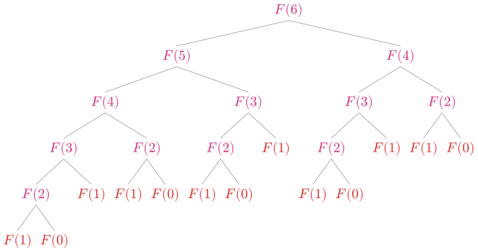

| 问题 | $F(6)$ | $F(5)$ | $F(4)$ | $F(3)$ | $F(2)$ | $\class{red}{F(1)}$ | $\class{red}{F(0)}$ |
| :--: | :----: | :----: | :----: | :----: | :----: | :-----------------: | :-----------------: |
| 个数 |  $1$   |  $1$   |  $2$   |  $3$   |  $5$   |         $8$         |         $5$         |

问题$F(n-k)$的个数为$F(k+1)$

<!-- slide data-notes="" -->

##### 备忘录

---

保持分治递归的形式，每个子问题第一次求解后将结果存下来，每碰到一个子问题，先检查是否已求解过，若否则求解保存

@import "../codes/dp/fibo.py" {line_begin=12 line_end=24 .line-numbers highlight=[]}

 备忘录英文为 <a href="https://en.wikipedia.org/wiki/Memoization" target="_blank">Memoization</a>，注意 i 前面没有 r，由英国人工智能先驱<a href="https://en.wikipedia.org/wiki/Donald_Michie" target="_blank">唐纳德·米奇</a>于 1967 年提出，但其实米奇本人只提出了 memo function 的概念，并没有用这个词，而更早的是香农在他 1950 年制造的机械鼠 <a href="https://en.wikipedia.org/wiki/Claude_Shannon#Shannon's_mouse" target="_blank">Theseus</a> 中就使用该词了

<!-- slide vertical=true data-notes="" -->

##### 备忘录

---

$F$的计算顺序为$F(2), F(3), \ldots, F(n)$

计算$F(2), F(3), \ldots, F(n)$只需做一次加法

$F(2), F(3), \ldots, F(n-2)$会被查询一次

时间复杂度$\Theta(n)$

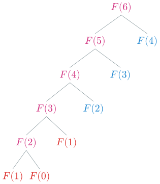

<!-- slide data-notes="" -->

##### 直接循环

---

既然$F$的计算顺序为$F(2), F(3), \ldots, F(n)$，为何不直接用循环？

@import "../codes/dp/fibo.py" {line_begin=29 line_end=38 .line-numbers highlight=[]}

只有一重循环，时间复杂度$\Theta(n)$

<!-- slide vertical=true data-notes="" -->

##### 直接循环

---

有时也未必需要记录所有子问题的结果，节省存储空间

@import "../codes/dp/fibo.py" {line_begin=43 line_end=51 .line-numbers .bottom2}

动态规划的两种实现方式：

<ol class="fragment" data-fragment-index="1">
    <li>带备忘录的自顶向下 (top-down with memoization)，递归实现</li>
    <li>自底向上 (bottom-up)，循环实现</li>
</ol>

<!-- slide data-notes="" -->

##### 动态规划 轶闻

---

动态规划 (dynamic programming, DP) 由美国数学家<a href="https://en.wikipedia.org/wiki/Richard_E._Bellman" target="_blank">理查德·贝尔曼</a>于 50 年代中期正式提出

programming 意为规划、计划、调度，不是编程的意思

- 线性规划 (linear programming)
- 电视节目单 (television programming)
- 学位课程计划 (degree program)

1940 年左右

- <a href="https://en.wikipedia.org/wiki/Pierre_Mass%C3%A9" target="_blank">Pierre Massé</a> 使用动态规划优化法国水电站的运行，发表于 1944 年
- 冯·诺伊曼使用动态规划研究完美信息博弈，发表于 1944 年
- 图灵使用动态规划破译密码，80 年代中期解密

<!-- slide vertical=true data-notes="" -->

##### 动态规划 轶闻

---

贝尔曼提出动态规划用于优化美国空军的训练和后勤保障

当时的国防部长是通用电气前首席执行官<a href="https://en.wikipedia.org/wiki/Charles_Edward_Wilson_(businessman)" target="_blank">威尔逊</a>，他非常讨厌数学研究，因此贝尔曼在起名上想方设法隐藏动态规划的数学味

> We had a very interesting gentleman in Washington named Wilson. He was secretary of Defense, and he actually had a pathological fear and hatred of the word "research". I'm not using the term lightly; I'm using it precisely. His face would suffuse, he would turn red, and he would get violent if people used the term "research" in his presence. You can imagine how he felt, then, about the term "mathematical" ...... I felt I had to do something to shield Wilson and the Air Force from the fact that I was really doing mathematics inside the RAND Corporation. What title, what name, could I choose?   &emsp; &emsp; &emsp; &emsp; &emsp; &emsp; &emsp; &emsp; &emsp; &emsp; &emsp; &emsp; &emsp; &emsp; &emsp; --- Bellman's autobiography, 1984

 事实上贝尔曼首次用动态规划这个词是在 1952 年，早于威尔逊去五角大楼任职数月

<!-- slide data-notes="" -->

##### 还能更快吗

---

根据递推关系有

\begin{align}
    & \begin{bmatrix} 0 & 1 \\ 1 & 1 \end{bmatrix} \begin{bmatrix} F(n-1) \\ F(n) \end{bmatrix} = \begin{bmatrix} F(n) \\ F(n-1) + F(n) \end{bmatrix} = \begin{bmatrix} F(n) \\ F(n+1) \end{bmatrix} \\[4pt]
    & \qquad \Longrightarrow \begin{bmatrix} 0 & 1 \\ 1 & 1 \end{bmatrix}^n \begin{bmatrix} F(0) \\ F(1) \end{bmatrix} = \begin{bmatrix} F(n) \\ F(n+1) \end{bmatrix}
\end{align}

利用矩阵乘法的结合律

\begin{align}
    & \begin{bmatrix} 0 & 1 \\ 1 & 1 \end{bmatrix}^2 = \begin{bmatrix} 0 & 1 \\ 1 & 1 \end{bmatrix} \begin{bmatrix} 0 & 1 \\ 1 & 1 \end{bmatrix}, \quad \begin{bmatrix} 0 & 1 \\ 1 & 1 \end{bmatrix}^4 = \begin{bmatrix} 0 & 1 \\ 1 & 1 \end{bmatrix}^2 \begin{bmatrix} 0 & 1 \\ 1 & 1 \end{bmatrix}^2, \quad \ldots
\end{align}

时间复杂度$\Theta(\lg n)$？

<!-- slide vertical=true data-notes="" -->

##### 还能更快吗 实现

---

对任意自然数$m$、$n$且$n \ge m+1$有

\begin{align}
    (\spadesuit) \quad F(n) = F(m) F(n-m-1) + F(m+1) F(n-m)
\end{align}

证明：注意$F(0) = 0$、$F(1) = 1$，对$\forall n \ge 1$有

\begin{align}
    F(n) = F(0) F(n-1) + F(1) F(n)
\end{align}

故式$(\spadesuit)$对$m = 0$、$n \ge 1$成立。固定$n$，假设式$(\spadesuit)$对$m = k$成立

\begin{align}
    F(n) & = F(k) F(n-k-1) + F(k+1) F(n-k) \\[3pt]
    & = F(k) F(n-k-1) \class{blue}{+ F(k+1) F(n-k-1)} + F(k+1) F(n-k) \class{blue}{- F(k+1) F(n-k-1)} \\[3pt]
    & = (F(k) + F(k+1)) F(n-k-1) + F(k+1) (F(n-k) - F(n-k-1)) \\[3pt]
    & = F(k+1) F(n-k-2) + F(k+2) F(n-k-1)
\end{align}

故式$(\spadesuit)$对$m = k+1$成立

<!-- slide vertical=true data-notes="" -->

##### 还能更快吗 实现

---

对任意自然数$m$、$n$且$n \ge m+1$有

\begin{align}
    (\spadesuit) \quad F(n) = F(m) F(n-m-1) + F(m+1) F(n-m)
\end{align}

- 若$n = 2k$为偶数，取$m = k$，则有$F(2k) = F(k) (2 \cdot F(k+1) - F(k))$
- 若$n = 2k+1$为奇数，取$m = k$，则有$F(2k+1) = F(k)^2 + F(k+1)^2$

@import "../codes/dp/fibo.py" {line_begin=56 line_end=70 .line-numbers .top2 .bottom2 .fragment}

<!-- slide vertical=true data-notes="" -->

##### 还能更快吗 总结

---

$F(n) = \frac{1}{\sqrt{5}} ( (\frac{1 + \sqrt{5}}{2})^n - (\frac{1 - \sqrt{5}}{2})^n )$，对于充分大的$n$

- $\lg F(n) \approx n \lg (\frac{1 + \sqrt{5}}{2}) \approx 2n /3$
- $\log_{10} F(n) \approx n \log_{10} (\frac{1 + \sqrt{5}}{2}) \approx n /5$

无论二进制还是十进制，打印一个斐波那契数就要$\Theta(n)$

在 fibo_rec_faster() 中，每次递归需计算若干次两个相邻斐波那契数的乘积，目前最快的两个$n$位数乘法的时间复杂度$O(n \lg n)$，因此$T(n) = T(n/2) + O(n \lg n)$，根据主定理情形 3，$T(n) = \Theta(n \lg n)$

在 fibo_dp_iter() 的一重循环中，每轮有两个$n$位数相加，时间复杂度$\Theta(n)$，因此总时间复杂度$\Theta(n^2)$

<!-- slide data-notes="" -->

##### 动态规划

---

动态规划是一种聪明的、不求解重复子问题的递归方式

动态规划通过保存部分子问题的解，以空间换时间，是一种时空权衡 (time-memory trade-off)

动态规划常用来求解最优化问题

<ul class="fragment" data-fragment-index="1">
    <li>最大收益的钢条切割方案</li>
    <li>最小开销的矩阵连乘方案</li>
    <li>最优二叉搜索树</li>
    <li>最长公共子序列</li>
    <li>最少编辑次数 (编辑距离)</li>
    <li>最长递增子序列</li>
    <li>最大连续子数组</li>
</ul>

<!-- slide vertical=true data-notes="" -->

##### 动态规划 一般步骤

---

第一阶段：自顶向下 递归 (recursive) 表示

1. 用清晰的语言描述问题
2. 将问题的解用规模更小的子问题的解表示出来

第二阶段：自底向上 递推 (recurrence) 求解

1. 确定保存子问题结果的数据结构，通常为多维表格
2. 除边界情况外，确定子问题间的依赖关系，这是一个偏序
3. 根据依赖关系确定子问题的求解顺序，将偏序转换为全序
4. 若除最优值外还需最优解本身，在第 1 步的多维表格里维护一些额外信息用于重构出最优解

<!-- slide data-notes="" -->

##### 钢条切割

---

@import "../md/rod.md"

假设切割钢条的工序本身没有成本

- 输入：长度$n$的钢条，价格表$p$
- 输出：最优分解$n = n_1 + \cdots + n_k$使$r_n = p[n_1] + \cdots + p[n_k]$最大化

递归表示：如何将$n$的最优分解用$m ~ (< n)$的最优分解表示出来？

<!-- slide vertical=true data-notes="" -->

##### 最优子结构

---

设最优分解为$n = n_1 + \cdots + n_k$

对任意索引集$\ic \subseteq \{1, \ldots, k\}$，记$\overline{\ic} = \{1, \ldots, k\} \setminus \ic$

设$m = \sum_{i \in \ic} n_i$，则

- $\sum_{i \in \ic} n_i$是$m$的最优分解
- $\sum_{i \in \overline{\ic}} n_i$是$n-m$的最优分解

若$\sum_{j \in \jc} n'_j = m$是更优分解，则$\sum_{j \in \jc} n'_j + \sum_{i \in \overline{\ic}} n_i$是$n$的更优分解

最优解的每个子部分都是子问题的最优解，称为最优子结构性

 最大子数组问题中亦有该性质，设$k$是属于最大子数组$a[i, \ldots, j]$的任意索引 (不局限于中点或某一固定点)，则$i$是以$k$为结束索引的最大子数组的开始索引、$j$是以$k+1$为开始索引的最大子数组的结束索引

<!-- slide vertical=true data-notes="" -->

##### 分治 双子问题

---

分：$n = m + (n-m)$

治：分别求$m$、$n-m$的最优分解对应的收益$r_m$、$r_{n-m}$

分解为$m$、$n-m$两部分本身未必是最优的，需遍历所有分解取最大

\begin{align}
    r_n = \begin{cases} \max \{ r_1 + r_{n-1}, ~ r_2 + r_{n-2}, ~ \ldots, ~ r_{\lfloor n/2 \rfloor} + r_{\lceil n/2 \rceil}, ~ p[n] \}, & n \le \len(p) \\ \max \{ r_1 + r_{n-1}, ~ r_2 + r_{n-2}, ~ \ldots, ~ r_{\lfloor n/2 \rfloor} + r_{\lceil n/2 \rceil} \}, & n > \len(p) \end{cases}
\end{align}

 从$(1,n-1)$到$(\lfloor n/2 \rfloor, \lceil n/2 \rceil)$即可遍历所有分解，在$n$不超过$p$的长度时还需考虑$p[n]$，它对应的是$r_0 + r_n$，但不能以这样的形式写，否则会出现无限递归

<!-- slide vertical=true data-notes="" -->

##### 分治 单子问题

---

分：$n = i + (n-i)$，将最优分解中的某个数视为一部分

治：只对$n-i$求最优分解对应的收益$r_{n-i}$

分解为$i$、$n-i$两部分未必是最优的，需遍历所有分解取最大

\begin{align}
    r_n = \begin{cases} \max \{ p[1] + r_{n-1}, ~ \ldots, ~ p[n-1] + r_1, ~ p[n] \}, & n \le \len(p) \\ \max \{ p[1] + r_{n-1}, ~ \ldots, ~ p[\len(p)] + r_{n - \len(p)} \}, & n > \len(p) \end{cases}
\end{align}

 单子问题产生的子问题更少，效率更优

<!-- slide vertical=true data-notes="" -->

##### 分治 实现

---

@import "../codes/dp/cut-rod.py" {line_begin=3 line_end=11 .line-numbers highlight=[]}

@import "../codes/dp/cut-rod.py" {line_begin=13 line_end=21 .line-numbers .top2 highlight=[]}

<!-- slide vertical=true data-notes="" -->

##### 分治 时间分析

---

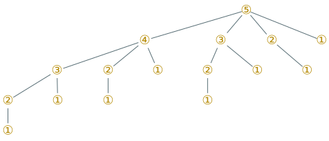

令$T(n)$表示求 cut_rod_rec(n,p) 的递归调用次数，则

\begin{align}
    T(n) & = \begin{cases} 1, & n = 1 \\ 1 + \sum_{i=1}^{n-1} T(i), & 1 < n \le \len(p) \\ 1 + \sum_{i=n-\len(p)}^{n-1} T(i), & n > \len(p) \end{cases}
\end{align}

$T(n)$的增长速度快于斐波那契数，至少是指数增长速度

<!-- slide data-notes="" -->

##### 动态规划 自顶向下

---

@import "../codes/dp/cut-rod.py" {line_begin=23 line_end=37 .line-numbers highlight=[9-10]}

每个子问题求解需执行第 9 ~ 10 行的一重循环

规模为$1,2,\ldots,n$的子问题各求解一次，时间复杂度$\Theta(n^2)$

<!-- slide vertical=true data-notes="" -->

##### 动态规划 自底向上

---

子问题按规模从小到大的顺序依次求解，当求解某个子问题时，它所依赖的更小子问题都已求解完毕

@import "../codes/dp/cut-rod.py" {line_begin=39 line_end=48 .line-numbers highlight=[4,6]}

二重循环时间复杂度$\Theta(n^2)$，一维表格空间复杂度$\Theta(n)$

<!-- slide vertical=true data-notes="" -->

##### 自顶向下 _vs._ 自底向上

---

两者有相同的渐近时间复杂度$\Theta(n^2)$

自顶向下

- 无需考虑求子问题的顺序，递归时碰到就求
- 实现容易，在分治递归的基础上加上备忘录查询/保存即可
- 存在递归的开销

自底向上

- 需自己事先指定求子问题的顺序
- 循环实现，没有递归的开销

<!-- slide data-notes="" -->

##### 重构最优切割方案

---

@import "../codes/dp/cut-rod.py" {line_begin=50 line_end=67 .line-numbers highlight=[3,6,10-11,13-17]}

|   长度$n$   |  0  |  1  |  2  |  3  |  4  |  5  |  6  |  7  |  8  |  9  | 10  | 11  | 12  | 13  | 14  |
| :---------: | :-: | :-: | :-: | :-: | :-: | :-: | :-: | :-: | :-: | :-: | :-: | :-: | :-: | :-: | :-: |
|   价格$p$   |  0  |  1  |  5  |  8  |  9  | 10  | 17  | 17  | 20  | 24  | 30  |  -  |  -  |  -  |  -  |
|   收益$r$   |  0  |  1  |  5  |  8  | 10  | 13  | 17  | 18  | 22  | 25  | 30  | 31  | 35  | 38  | 40  |
| 切割位置$s$ |  -  |  1  |  2  |  3  |  2  |  2  |  6  |  1  |  2  |  3  | 10  |  1  |  2  |  3  |  2  |

<!-- slide data-notes="" -->

##### 子问题图

---

动态规划子问题之间的依赖关系，可用子问题图描述

- 子问题图是一个有向图，每个顶点唯一地对应一个子问题
- 子问题 x 的最优解依赖子问题 y，则有一条从 x 到 y 的有向边
- 递归树中相同子问题的结点合并为一，相关的边从父结点指向子结点

        
    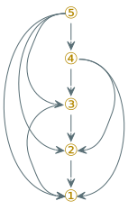

<!-- slide vertical=true data-notes="" -->

##### 子问题图

---

自底向上处理子问题的顺序：

- 对任意子问题，先求解它指向的子问题
- 当它指向的所有子问题都求解完才会求解它

算法运行时间等于所有子问题求解时间之和

子问题的求解时间与对应顶点的出度成正比

动态规划的运行时间一般与顶点和边的数量至少呈线性关系

<!-- slide data-notes="" -->

##### 矩阵连乘

---

设$\Av \in \rb^{p \times q}$、$\Bv \in \rb^{q \times r}$，则$\Cv = \Av \Bv \in \rb^{p \times r}$

计算$c_{ij} = \sum_{1 \le k \le q} a_{ik} b_{kj}$需做$q$次标量乘法，计算$\Cv$需$pqr$次标量乘法

设$\Av_1 \in \rb^{10 \times 100}$、$\Av_2 \in \rb^{100 \times 5}$、$\Av_3 \in \rb^{5 \times 50}$

<ul>
    <li class="fragment">$(\Av_1 \Av_2) \Av_3$：共$10 \times 100 \times 5 + 10 \times 5 \times 50 = 7500$次标量乘法</li>
    <li class="fragment">$\Av_1 (\Av_2 \Av_3)$：共$100 \times 5 \times 50 + 10 \times 100 \times 50 = 75000$次标量乘法</li>
</ul>

给定矩阵序列，按什么顺序相乘才能使总代价最小呢？

<!-- slide vertical=true data-notes="" -->

##### 矩阵连乘

---

输入：$n$个矩阵，$\Av_1 \in \rb^{p_0 \times p_1}$、$\Av_2 \in \rb^{p_1 \times p_2}$、……、$\Av_n \in \rb^{p_{n-1} \times p_n}$

输出：计算代价最小的连乘顺序对应的加括号方案

令$P(n)$表示$n$个矩阵连乘时总的括号化方案的数量

<ul>
    <li class="fragment" data-fragment-index="2">$n = 1, 2$：显然此时$P(1) = P(2) = 1$</li>
    <li class="fragment" data-fragment-index="3">$n = 3$：有$(\Av_1 \Av_2) \Av_3$、$\Av_1 (\Av_2 \Av_3)$两种方案，$P(3) = 2$</li>
    <li class="fragment" data-fragment-index="4">$n = 4$：$(\Av_1 \Av_2 \Av_3) \Av_4$有$P(3) \cdot P(1) = 2$种方案，同理$\Av_1 (\Av_2 \Av_3 \Av_4)$有$2$种方案，$(\Av_1 \Av_2)(\Av_3 \Av_4)$有$P(2) \cdot P(2) = 1$种方案，故$P(4) = 2+1+2=5$</li>
</ul>

一般性结论：

\begin{align}
    P(n) = P(n-1) \cdot P(1) + P(n-2) \cdot P(2) + \cdots = \sum_{k=1}^{n-1} P(k) P(n-k)
\end{align}

<!-- slide vertical=true data-notes="" -->

##### 矩阵连乘

---

\begin{align}
    P(n) = \sum_{k=1}^{n-1} P(k) P(n-k) = \frac{1}{n} \binom{2n-2}{n-1} = C_{n-1}
\end{align}

其中$C_n = \frac{1}{n+1} \binom{2n}{n}$称为<a href="https://en.wikipedia.org/wiki/Catalan_number" target="_blank">卡特兰数</a> (Catalan number)

由<a href="https://en.wikipedia.org/wiki/Stirling%27s_approximation" target="_blank">斯特林公式</a>$n! = \sqrt{2 \pi n} (n/e)^n$知$C_n = \Theta(4^n / n^{3/2})$呈指数增长

不同场景中的卡特兰数：

<ol class="fragment" data-fragment-index="2">
    <li>给定进栈顺序的$n$个元素的不同出栈序列个数</li>
    <li>$n+1$个叶结点构成的不同 (国际) 满二叉树的个数</li>
    <li>$2n$个高矮不同的人排成两队，每队$n$个人，每排都是从低到高排，且第二排的第$i$个人比第一排中第$i$个人高，总的排队方式</li>
</ol>

<!-- slide data-notes="" -->

##### 最优子结构

---

子问题：$\Av_i \cdots \Av_j$的最优加括号方案

用上划线表示加括号方案$\overline{\Av_i \cdots \Av_j}$，$\star$表示最优

假设$\Av_i \cdots \Av_j$的最优加括号方案在$\Av_k$和$\Av_{k+1}$之间分开：

\begin{align}
    \overline{\Av_i \cdots \Av_j}^\star = (\overline{\Av_i \cdots \Av_k}) (\overline{\Av_{k+1} \cdots \Av_j})
\end{align}

则必然有

- $\overline{\Av_i \cdots \Av_k} = \overline{\Av_i \cdots \Av_k}^\star$
- $\overline{\Av_{k+1} \cdots \Av_j} = \overline{\Av_{k+1} \cdots \Av_j}^\star$

问题：如何确定最优的分开位置$k$呢？

<!-- slide vertical=true data-notes="" -->

##### 动态规划

---

$\Av_i \in \rb^{p_{i-1} \times p_i}$、$\Av_k \in \rb^{p_{k-1} \times p_k}$、$\Av_{k+1} \in \rb^{p_k \times p_{k+1}}$、$\Av_j \in \rb^{p_{j-1} \times p_j}$

$\Av_i \cdots \Av_k \in \rb^{p_{i-1} \times p_k}$、$\Av_{k+1} \cdots \Av_j \in \rb^{p_k \times p_j}$

令$m[i,j]$表示计算$\Av_i \cdots \Av_j$所需的最少标量乘法次数

\begin{align}
    m[i,j] = \begin{cases} 0, & n = 1 \\ \min_{i \le k < j} \{ m[i,k] + m[k+1,j] + p_{i-1} p_k p_j \}, & n > 1 \end{cases}
\end{align}

子问题$\Av_i \cdots \Av_j$的矩阵个数$l = 2 \rightarrow n$

<ul class="fragment">
    <li>$l = 2$：$\Av_1 \Av_2$、$\Av_2 \Av_3$、……、$\Av_{n-1} \Av_n$</li>
    <li>$l = 3$：$\Av_1 \Av_2 \Av_3$、$\Av_2 \Av_3 \Av_4$、……、$\Av_{n-2} \Av_{n-1} \Av_n$</li>
    <li>$\qquad \vdots$</li>
    <li>$l = n-1$：$\Av_1 \Av_2 \cdots \Av_{n-1}$、$\Av_2 \Av_3 \cdots \Av_n$</li>
    <li>$l = n$：$\Av_1 \Av_2 \cdots \Av_{n-1} \Av_n$</li>
</ul>

<!-- slide vertical=true data-notes="" -->

##### 动态规划

---

\begin{align}
    m[i,j] = \begin{cases} 0, & n = 1 \\ \min_{i \le k < j} \{ m[i,k] + m[k+1,j] + p_{i-1} p_k p_j \}, & n > 1 \end{cases}
\end{align}

$s[i,j]$表示$\Av_i \cdots \Av_j$的最优分开位置，用来重构最优解

@import "../codes/dp/matrix-chain.py" {line_begin=3 line_end=17 .line-numbers highlight=[5-6,9]}

三重循环时间复杂度$\Theta(n^3)$，二维表格空间复杂度$\Theta(n^2)$

<!-- slide data-notes="" -->

##### 例子

---

| 矩阵 |    $\Av_1$     |    $\Av_2$     |    $\Av_3$    |    $\Av_4$    |    $\Av_5$     |    $\Av_6$     |
| :--: | :------------: | :------------: | :-----------: | :-----------: | :------------: | :------------: |
| 尺寸 | $30 \times 35$ | $35 \times 15$ | $15 \times 5$ | $5 \times 10$ | $10 \times 20$ | $20 \times 25$ |

- $m[i,j]$表示计算$\Av_i \cdots \Av_j$所需的最少标量乘法次数
- $s[i,j]$表示$\Av_i \cdots \Av_j$的最优分开位置，用来重构最优解

采用自底向上法，子问题$\Av_i \cdots \Av_j$的矩阵个数为$l = 1 \rightarrow 6$

\begin{align}
    l=1: m[1,1] & = m[2,2] = \cdots = m[6,6] = 0, ~ s[i,i] = \text{None} \\[4pt]
          l=2: m[1,2] & = 30 \times 35 \times 15 = 15750, ~ s[1,2] = 1 \\
               m[2,3] & = 35 \times 15 \times 5 = 2625, ~ s[2,3] = 2 \\
               m[3,4] & = 15 \times 5 \times 10 = 750, ~ s[3,4] = 3 \\
               m[4,5] & = 5 \times 10 \times 20 = 1000, ~ s[4,5] = 4 \\
               m[5,6] & = 10 \times 20 \times 25 = 5000, ~ s[5,6] = 5
\end{align}

<!-- slide vertical=true data-notes="" -->

##### 例子 填表

---

| $p_0$ | $p_1$ | $p_2$ | $p_3$ | $p_4$ | $p_5$ | $p_6$ |
| :---: | :---: | :---: | :---: | :---: | :---: | :---: |
| $30$  | $35$  | $15$  |  $5$  | $10$  | $20$  | $25$  |

\begin{align}
    m[i,j] & = \begin{cases} 0, & n = 1 \\ \min_{i \le k < j} \{ m[i,k] + m[k+1,j] + p_{i-1} p_k p_j \}, & n > 1 \end{cases} \\[4pt]
    m[1,1] & = m[2,2] = \cdots = m[6,6] = 0 \\[4pt]
    m[1,2] & = 15750, ~ m[2,3] = 2625, ~ m[3,4] = 750, ~ m[4,5] = 1000, ~ m[5,6] = 5000 \\[4pt]
    m[1,3] & = \min \{m[1,1] + m[2,3] + p_0 p_1 p_3, ~ m[1,2] + m[3,3] + p_0 p_2 p_3 \} \\
            & = \min \{ 2625 + 30 \times 35 \times 5, ~ 15750 + 30 \times 15 \times 5 \} \\
            & = \min \{ \class{blue}{2625 + 5250}, ~ 15750 + 2250 \} = 7875, ~ s[1,3] = 1 \\
    m[2,4] & = \min \{m[2,2] + m[3,4] + p_1 p_2 p_4, ~ m[2,3] + m[4,4] + p_1 p_3 p_4 \} \\
            & = \min \{ 750 + 35 \times 15 \times 10, ~ 2625 + 35 \times 5 \times 10 \} \\
            & = \min \{ 750 + 5250, ~ \class{blue}{2625 + 1750} \} = 4375, ~ s[2,4] = 3
\end{align}

<!-- slide vertical=true data-notes="" -->

##### 例子 填表

---

| $p_0$ | $p_1$ | $p_2$ | $p_3$ | $p_4$ | $p_5$ | $p_6$ |
| :---: | :---: | :---: | :---: | :---: | :---: | :---: |
| $30$  | $35$  | $15$  |  $5$  | $10$  | $20$  | $25$  |

\begin{align}
    m[i,j] & = \begin{cases} 0, & n = 1 \\ \min_{i \le k < j} \{ m[i,k] + m[k+1,j] + p_{i-1} p_k p_j \}, & n > 1 \end{cases} \\[4pt]
    m[1,1] & = m[2,2] = \cdots = m[6,6] = 0 \\[4pt]
    m[1,2] & = 15750, ~ m[2,3] = 2625, ~ m[3,4] = 750, ~ m[4,5] = 1000, ~ m[5,6] = 5000 \\[4pt]
    m[1,3] & = 7875, ~ m[2,4] = 4375, ~ m[3,5] = 2500, ~ m[4,6] = 3500 \\[4pt]
    m[1,4] & = \min \{m[1,1] + m[2,4] + p_0 p_1 p_4, ~ m[1,2] + m[3,4] + p_0 p_2 p_4, \\
            & \qquad \qquad m[1,3] + m[4,4] + p_0 p_3 p_4 \} \\
            & = \min \{ 4375 + 30 \times 35 \times 10, ~ 15750 + 750 + 30 \times 15 \times 10, \\
            & \qquad \qquad 7875 + 30 \times 5 \times 10 \} \\
            & = \min \{ 14875, ~ 21000, ~ \class{blue}{9375} \} = 9375, ~ s[1,4] = 3
\end{align}

<!-- slide vertical=true data-notes="" -->

##### 例子 填表

---

\begin{align}
    m[i,j] = \begin{cases} 0, & n = 1 \\ \min_{i \le k < j} \{ m[i,k] + m[k+1,j] + p_{i-1} p_k p_j \}, & n > 1 \end{cases}
\end{align}

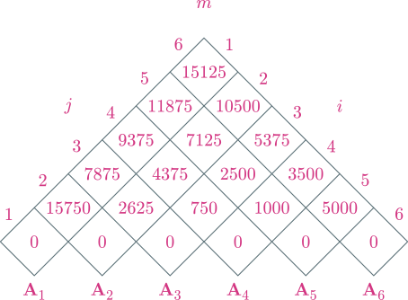

$m[1,6] = 15125$即为$\Av_1 \cdots \Av_6$的最优加括号方案的乘法次数

<!-- slide data-notes="" -->

##### 重构最优解

---

$s[i,j]$表示$\Av_i \cdots \Av_j$的最优分开位置

- $s[1,6]=3$，故$\Av_1 \cdots \Av_6$在$\Av_3$后分开
- $s[1,3]=1$，故$\Av_1 \cdots \Av_3$在$\Av_1$后分开
- $s[4,6]=5$，故$\Av_4 \cdots \Av_6$在$\Av_5$后分开

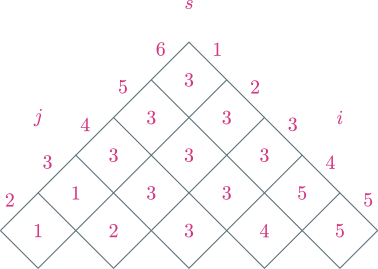

@import "../codes/dp/matrix-chain.py" {line_begin=45 line_end=64 .line-numbers .top-14 .bottom2}

<!-- slide data-notes="" -->

##### 语言翻译

---

对每个单词，在字典里找该词的翻译

| When  | you | play | the | game  | of  | thrones |   ,    |  you   | win |
| :---: | :-: | :--: | :-: | :---: | :-: | :-----: | :----: | :----: | :-: |
| 当…时 | 你  |  玩  |  >  | 游戏  | 的  |  权力   |   ,    |   你   | 赢  |
|  or   | you | die  |  .  | There | is  |   no    | middle | ground |  .  |
|  或   | 你  |  死  |  .  |   >   | 有  |   没    |  中间  |  地带  |  .  |

有时也会碰到字典中没有的词

Daenerys Stormborn of House Targaryen, the First of Her Name, Queen of the Andals, the Rhoynar and the First Men, Queen of Meereen, Protector of the Realm, Lady Regnant of the Seven Kingdoms, Mother of Dragons, Khaleesi of the Great Grass Sea, the Unburnt, Breaker of Chains.

<!-- slide vertical=true data-notes="" -->

##### 二叉搜索树

---

方法：以单词作关键字建二叉搜索树

目标：尽快找到单词，期望搜索时间最少

<ul>
    <li class="fragment">第$i$层的关键字比较$i$次可以找到</li>
    <li class="fragment">左子树的所有元素比根结点小</li>
    <li class="fragment">右子树的所有元素比根结点大</li>
    <li class="fragment">左、右子树也是二叉搜索树</li>
</ul>

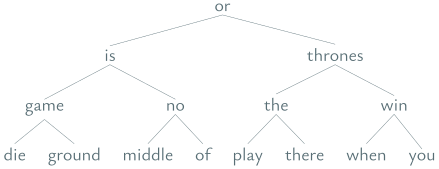

 本页 15 个结点的二叉树根据字典序而来

<!-- slide vertical=true data-notes="" -->

##### 二叉搜索树

---

频繁被查询的单词靠近根可减少期望比较次数

$n$个关键字产生$n+1$个区间$d_i = (k_i, k_{i+1})$

- 不在词典中的词会落入其中之一的区间
- $n+1$个区间对应二叉搜索树的叶结点的子结点

 这些区间称为伪关键字

<!-- slide data-notes="" -->

##### 最优二叉搜索树

---

输入：

- $n$个排好序的关键字$k_1 < k_2 < \cdots < k_n$及其概率$\pb [x = k_i] = p_i$
- $n+1$个伪关键字$d_0, d_1, \ldots, d_n$及其概率$\pb [x \in d_i] = q_i$

输出：以$k_1, k_2, \ldots, k_n$为内部结点、$d_0, d_1, \ldots, d_n$为叶结点的最优二叉搜索树 (optimal binary search tree, OBST)，期望搜索时间最少

\begin{align}
    \eb [搜索时间] & = \sum_{i=1}^n (\dep (k_i) + 1) \cdot p_i + \sum_{i=0}^n (\dep (d_i) + 1) \cdot q_i \\
    & = 1 + \sum_{i=1}^n \dep (k_i) \cdot p_i + \sum_{i=0}^n \dep (d_i) \cdot q_i
\end{align}

其中第二个等号是根据$\sum_{i=1}^n p_i + \sum_{i=0}^n q_i = 1$

<!-- slide vertical=true data-notes="" -->

##### 例子

---

有$n = 5$个关键字，$6$个伪关键字

|  $i$  |   0    |  1   |  2   |  3   |  4   |  5  |
| :---: | :----: | :--: | :--: | :--: | :--: | :-: |
| $p_i$ | &zwnj; | 0.15 | 0.1  | 0.05 | 0.1  | 0.2 |
| $q_i$ |  0.05  | 0.1  | 0.05 | 0.05 | 0.05 | 0.1 |

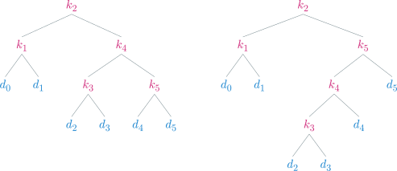

<!-- slide vertical=true data-notes="" -->

##### 例子

---

| 关键字 | $k_1$ | $k_2$ | $k_3$ | $k_4$ | $k_5$ | $d_0$ | $d_1$ | $d_2$ | $d_3$ | $d_4$ | $d_5$ |  总计  |
| :----: | :---: | :---: | :---: | :---: | :---: | :---: | :---: | :---: | :---: | :---: | :---: | :----: |
|  概率  | 0.15  |  0.1  | 0.05  |  0.1  |  0.2  | 0.05  |  0.1  | 0.05  | 0.05  | 0.05  |  0.1  |   1    |
|  深度  |   1   |   0   |   2   |   1   |   2   |   2   |   2   |   3   |   3   |   3   |   3   | &zwnj; |
|  贡献  |  0.3  |  0.1  | 0.15  |  0.2  |  0.6  | 0.15  |  0.3  |  0.2  |  0.2  |  0.2  |  0.4  |  2.8   |
|  深度  |   1   |   0   |   3   |   2   |   1   |   2   |   2   |   4   |   4   |   3   |   2   | &zwnj; |
|  贡献  |  0.3  |  0.1  |  0.2  |  0.3  |  0.4  | 0.15  |  0.3  | 0.25  | 0.25  |  0.2  |  0.3  |  2.75  |

<!-- slide data-notes="" -->

##### 最优子结构

---

如果$\tc$是关于关键字$k_1, \ldots, k_n$和伪关键字$d_0, \ldots, d_n$的 OBST，则$\tc$中仅包含$k_i, \ldots, k_j$和$d_{i-1}, \ldots, d_j$的子树$\tc'$必然也是 OBST

反设$\tc'$不是最优，则存在更优的$\tc''$，将$\tc$中的$\tc'$替换成$\tc''$可以得到比$\tc$更优的 OBST

子问题：仅包含$k_i, \ldots, k_j$和$d_{i-1}, \ldots, d_j$的 OBST

<ul>
    <li class="fragment" data-fragment-index="3">边界情况：$j=i-1$，只有一个伪关键字</li>
    <li class="fragment" data-fragment-index="4">非边界情况：设最优根结点是$k_t$</li>
    <ul>
        <li class="fragment" data-fragment-index="4">左子树是仅包含$k_i, \ldots, k_{t-1}$的 OBST</li>
        <li class="fragment" data-fragment-index="4">右子树是仅包含$k_{t+1}, \ldots, k_j$的 OBST</li>
    </ul>
</ul>

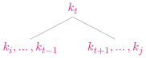

<!-- slide vertical=true data-notes="" -->

##### 递推关系

---

子问题：仅包含$k_i, \ldots, k_j$和$d_{i-1}, \ldots, d_j$的 OBST

设$e[i,j]$是子问题 OBST 的期望搜索代价

<ul class="fragment" data-fragment-index="1">
    <li>边界情况：只有一个伪关键字$q_{i-1}$，$e[i,j] = q_{i-1}$</li>
    <li>非边界情况：设最优根结点是$k_t$</li>
</ul>

\begin{align}
    e[i,j] & = p_t + e[i,t-1] + w (i,t-1) + e[t+1,j] + w(t+1,j) \\
    & = e[i,t-1] + e[t+1,j] + w(i,j)
\end{align}

其中左子树$+w(i,t-1)$、右子树$+w(t+1,j)$是因为它们成为$k_t$的子结点时，所有结点深度加$\class{blue}{1}$

 $w(i,j) = \sum_{l=i}^j p_l + \sum_{l=i-1}^j q_l$是结点概率和
 

<!-- slide vertical=true data-notes="" -->

##### 实现

---

设$r[i,j]$是仅包含$k_i, \ldots, k_j$和$d_{i-1}, \ldots, d_j$的 OBST 的根结点

\begin{align}
    e[i,j] = \begin{cases} q_{i-1}, & j = i - 1 \\ \min_{i \le t \le j} ~ \{ e[i,t-1] + e[t+1,j] + w(i,j) \}, & i \le j \end{cases}
\end{align}

@import "../codes/dp/optimal-bst.py" {line_begin=4 line_end=21 .line-numbers highlight=[8-9,12] .fragment}

三重循环时间复杂度$\Theta(n^3)$，二维表格空间复杂度$\Theta(n^2)$

<!-- slide data-notes="" -->

##### 例子 填表

---

@import "../md/obst.md"

\begin{align}
    w(i,j) & = q_{i-1} + p_i + q_i + \cdots + p_j + q_j \\[2pt]
    w(1,0) & = q_0 = 0.05, ~ w(2,1) = q_1 = 0.1, ~ w(3,2) = q_2 = 0.05 \\
    w(4,3) & = q_3 = 0.05, ~ w(5,4) = q_4 = 0.05, ~ w(6,5) = q_5 = 0.1 \\[2pt]
    w(1,1) & = q_0 + p_1 + q_1 = 0.05 + 0.15 + 0.1 = 0.3, ~ \ldots, ~ w(5,5) = 0.35 \\[2pt]
    w(1,2) & = q_0 + p_1 + q_1 + p_2 + q_2 = 0.45, ~ \ldots, ~ w(4,5) = 0.5 \\[2pt]
    w(1,3) & = q_0 + p_1 + q_1 + p_2 + q_2 + p_3 + q_3 = 0.55, ~ \ldots, ~ w(3,5) = 0.6 \\[2pt]
    w(1,4) & = q_0 + p_1 + q_1 + p_2 + q_2 + p_3 + q_3 + p_4 + q_4 = 0.7, ~ w(2,5) = 0.8 \\[2pt]
    w(1,5) & = 1
\end{align}

<!-- slide vertical=true data-notes="" -->

##### 例子 填表

---

@import "../md/obst.md"

\begin{align}
    e[i,j] & = \begin{cases} q_{i-1}, & j = i - 1 \\ \min_{i \le t \le j} ~ \{ e[i,t-1] + e[t+1,j] + w(i,j) \}, & i \le j \end{cases} \\[2pt]
    e[1,0] & = q_0 = 0.05, ~ e[2,1] = q_1 = 0.1, ~ e[3,2] = q_2 = 0.05 \\
    e[4,3] & = q_3 = 0.05, ~ e[5,4] = q_4 = 0.05, ~ e[6,5] = q_5 = 0.1 \\[2pt]
    e[1,1] & = e[1,0] + e[2,1] + w(1,1) = 0.05 + 0.1 + 0.3 = 0.45, ~ r[1,1] = 1 \\
    e[2,2] & = e[2,1] + e[3,2] + w(2,2) = 0.1 + 0.05 + 0.25 = 0.4, ~ r[2,2] = 2 \\
    e[3,3] & = e[3,2] + e[4,3] + w(3,3) = 0.05 + 0.05 + 0.15 = 0.25, ~ r[3,3] = 3 \\
    e[4,4] & = e[4,3] + e[5,4] + w(4,4) = 0.05 + 0.05 + 0.2 = 0.3, ~ r[4,4] = 4 \\
    e[5,5] & = e[5,4] + e[6,5] + w(5,5) = 0.05 + 0.1 + 0.35 = 0.5, ~ r[5,5] = 5
\end{align}

<!-- slide vertical=true data-notes="" -->

##### 例子 填表

---

@import "../md/obst.md"

\begin{align}
    e[i,j] & = \begin{cases} q_{i-1}, & j = i - 1 \\ \min_{i \le t \le j} ~ \{ e[i,t-1] + e[t+1,j] + w(i,j) \}, & i \le j \end{cases} \\[2pt]
    e[1,2] & = \min \{ e[1,0] + e[2,2], ~ e[1,1] + e[3,2]\} + w(1,2) \\
    & = \min \{ \class{blue}{0.05 + 0.4}, ~ 0.45 + 0.05 \} + 0.45 = 0.9, ~ r[1,2] = 1 \\
    e[2,3] & = \min \{ e[2,1] + e[3,3], ~ e[2,2] + e[4,3]\} + w(2,3) \\
    e[3,4] & = \min \{ e[3,2] + e[4,4], ~ e[3,3] + e[5,4]\} + w(3,4) \\
    e[4,5] & = \min \{ e[4,3] + e[5,5], ~ e[4,4] + e[6,5]\} + w(4,5) \\[2pt]
    e[1,3] & = \min \{ e[1,0] + e[2,3], ~ e[1,1] + e[3,3], ~ e[1,2] + e[4,3] \} + w(1,3) \\
    e[2,4] & = \min \{ e[2,1] + e[3,4], ~ e[2,2] + e[4,4], ~ e[2,3] + e[5,4] \} + w(2,4) \\
    & \qquad \vdots
\end{align}

<!-- slide vertical=true data-notes="" -->

##### 例子 填表

---

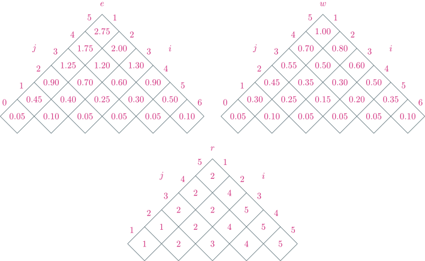

<!-- slide data-notes="" -->

##### 重构最优解

---

$r[i,j]$表示仅包含$k_i, \ldots, k_j$和$d_{i-1}, \ldots, d_j$的 OBST 的根结点

- $r[1,5]=2$，故$k_2$是 OBST 的根结点
- $r[1,1]=1$，故$k_2$的左子结点是$k_1$
- $r[3,6]=5$，故$k_2$的右子结点是$k_5$

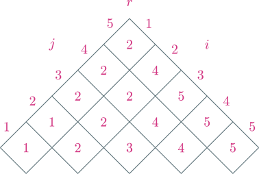

@import "../codes/dp/optimal-bst.py" {line_begin=62 line_end=102 .line-numbers .top-8 .bottom4}

<!-- slide data-notes="" -->

##### 阶段性小结

---

第一阶段：自顶向下 递归 (recursive) 表示

1. 用清晰的语言描述问题
2. 将问题的解用规模更小的子问题的解表示出来

第二阶段：自底向上 递推 (recurrence) 求解

1. 确定保存子问题结果的数据结构，通常为多维表格
2. 除边界情况外，确定子问题间的依赖关系，这是一个偏序
3. 根据依赖关系确定子问题的求解顺序，将偏序转换为全序
4. 若除最优值外还需最优解本身，在第 1 步的多维表格里维护一些额外信息用于重构出最优解

对最优化问题，递归表示中第二步就是在判断最优子结构性

- 最优钢条切割方案的任意部分也是最优的
- 最优矩阵连乘方案的任意部分也是最优的
- 最优二叉搜索树的任意子树也是最优的

<!-- slide vertical=true data-notes="" -->

##### 最优子结构性成立

---

有向图上的无权最短路径具有最优子结构性

设$u \ne v$，$u$到$v$的最短路径为$p$，记为$u \overset{p}{\rightsquigarrow} v$

路径$p$上的中间结点$w$将$p$分为$p_1$、$p_2$两部分，$u \overset{p_1}{\rightsquigarrow} w \overset{p_2}{\rightsquigarrow} v$

<ul class="fragment">
    <li>$p_1$是从$u$到$w$的最短路径，否则设$p'_1$更短，则$u \overset{p'_1}{\rightsquigarrow} w \overset{p_2}{\rightsquigarrow} v$也更短</li>
    <li>$p_2$是从$w$到$v$的最短路径，否则设$p'_2$更短，则$u \overset{p_1}{\rightsquigarrow} w \overset{p'_2}{\rightsquigarrow} v$也更短</li>
</ul>

最优子结构性均可用上述反证法来证，称为剪切-粘贴技术

<ol class="fragment">
    <li>假设子问题的解不是其自身的最优解，最优解另有其解</li>
    <li>将该解剪掉，并将最优解粘进来，从而得到原问题的一个更优解</li>
    <li>这与最初的解是原问题的最优解矛盾</li>
</ol>

<!-- slide vertical=true data-notes="" -->

##### 最优子结构性不成立

---

有向图上的无权最长简单 (无环) 路径不具有最优子结构性

- ①=>②=>③ 是 ① 到 ③ 的一条最长路径
- ①=>② 不是 ① 到 ② 的最长路径 (①=>④=>③=>②)
- ②=>③ 不是 ② 到 ③ 的最长路径 (②=>①=>④=>③)
- ①=>② 的最长路径连上 ②=>③ 的最长路径不是简单路径

@import "../dot/dp/longest-path.dot" {.left82per .top-18 .bottom2}

区别的根源：子问题无关性，同一个原问题的子问题相互独立

最短路径的两个子问题相互独立，$p_1$、$p_2$除$w$外没有公共点，否则设公共点为$x$，则$u \rightsquigarrow x \rightsquigarrow w \rightsquigarrow x \rightsquigarrow v$可优化为$u \rightsquigarrow x \rightsquigarrow v$

最长路径的两个子问题不独立，子问题 ① 到 ② 的最长路径经过的点，在子问题 ② 到 ③ 的最长路径中不能再经过，否则构成环，换言之子问题 ① 到 ② 的求解影响了子问题 ② 到 ③ 的求解

<!-- slide data-notes="" -->

##### 序列比对

---

DNA 由 A、C、G、T 四种碱基组成，现有两个有机体的 DNA

- S1 = ACCGGTCGAGTGCGCGGAAGCCGGCCGAA
- S2 = GTCGTTCGGAATGCCGTTGCTCTGTAAA

两个有机体有多“相似”，基因序列比对

序列 S3 = GTCGTCGGAAGCCGGCCGAA 中的基以同样的顺序出现在序列 S1 和 S2 中 (不需要在 S1 和 S2 中连续)，两个序列的最长公共子序列 (longest common subsequence, LCS) 的长度可以视为相似度

将其中一个序列转换成另一个所需的最少的插入/删除/替换次数，即编辑距离 (edit distance) 可以视为相似度

<!-- slide data-notes="" -->

##### 最长公共子序列

---

序列$X = \langle x_1, x_2, \ldots, x_m \rangle$、$Y = \langle y_1, y_2, \ldots, y_n \rangle$

设序列$Z = \langle z_1, z_2, \ldots, z_k \rangle$是$X$、$Y$的任意 LCS

序列的子结构当然是子序列

记$Z$的前$i$个元素构成的前缀子序列为$Z_i = \langle z_1, z_2, \ldots, z_i \rangle$

$Z_i$是什么子问题的最优解?

<!-- slide vertical=true data-notes="" -->

##### 最优子结构

---

| $X_{m-1} = \langle x_1, x_2, \ldots, x_{m-1} \rangle$ |                               $x_m$                               |
| :---------------------------------------------------: | :---------------------------------------------------------------: |
| $Y_{n-1} = \langle y_1, y_2, \ldots, y_{n-1} \rangle$ |                               $y_n$                               |
|                           >                           | LCS：$Z_{k-1} = \langle z_1, z_2, \ldots, z_{k-1} \rangle, ~ z_k$ |

情形 1：若$x_m = y_n$，则$z_k = x_m = y_n$且$Z_{k-1}$是$X_{m-1}$和$Y_{n-1}$的 LCS

证明：反设$z_k \ne x_m = y_n$，将$x_m$接到$Z$的末尾可以得到一个长为$k+1$的公共子序列，这与$Z$的最优性矛盾

已证$z_k = x_m = y_n$，故$Z_{k-1}$是$X_{m-1}$和$Y_{n-1}$的公共子序列，若其不是最长，则另有一个长度大于$k-1$的公共子序列，将$x_m$接到其末尾可以得到$X$和$Y$的一个长度大于$k$的公共子序列，矛盾

<!-- slide vertical=true data-notes="" -->

##### 最优子结构

---

| $X_{m-1} = \langle x_1, x_2, \ldots, x_{m-1} \rangle$ |                               $x_m$                               |
| :---------------------------------------------------: | :---------------------------------------------------------------: |
| $Y_{n-1} = \langle y_1, y_2, \ldots, y_{n-1} \rangle$ |                               $y_n$                               |
|                           >                           | LCS：$Z_{k-1} = \langle z_1, z_2, \ldots, z_{k-1} \rangle, ~ z_k$ |

情形 2：若$x_m \ne y_n$，则$z_k \ne x_m$蕴含$Z$是$X_{m-1}$和$Y$的一个 LCS

证明：若$z_k \ne x_m$，$Z$显然是$X_{m-1}$和$Y$的公共子序列，若其不是最长，则另有一个长度大于$k$的子序列，该子序列也是$X$和$Y$的子序列，这与$Z$的最优性矛盾

情形 3：若$x_m \ne y_n$，则$z_k \ne y_n$蕴含$Z$是$X$和$Y_{n-1}$的一个 LCS

<!-- slide vertical=true data-notes="" -->

##### 递推关系

---

| $X_{m-1} = \langle x_1, x_2, \ldots, x_{m-1} \rangle$ |                               $x_m$                               |
| :---------------------------------------------------: | :---------------------------------------------------------------: |
| $Y_{n-1} = \langle y_1, y_2, \ldots, y_{n-1} \rangle$ |                               $y_n$                               |
|                           >                           | LCS：$Z_{k-1} = \langle z_1, z_2, \ldots, z_{k-1} \rangle, ~ z_k$ |

- 若$x_m = y_n$，则$z_k = x_m = y_n$且$Z_{k-1}$是$X_{m-1}$和$Y_{n-1}$的 LCS
- 若$x_m \ne y_n$，则$z_k \ne x_m$蕴含$Z$是$X_{m-1}$和$Y$的一个 LCS
- 若$x_m \ne y_n$，则$z_k \ne y_n$蕴含$Z$是$X$和$Y_{n-1}$的一个 LCS

记$c[i,j]$为$X_i$和$Y_j$的 LCS 的长度：

\begin{align}
    c[i,j] = \begin{cases} 0, & i = 0 ~ 或 ~ j = 0 \\ c[i-1,j-1]+1, & i,j > 0 ~ 且 ~ x_i = y_j \\ \max \{ c[i,j-1], ~ c[i-1,j] \}, & i,j > 0 ~ 且 ~ x_i \ne y_j \end{cases}
\end{align}

<!-- slide data-notes="" -->

##### 实现

---

$c[i,j]$为$X_i$和$Y_j$的 LCS 的长度，$b[i,j]$记录$c[i,j]$的计算情况

\begin{align}
    c[i,j] = \begin{cases} 0, & i = 0 ~ 或 ~ j = 0 \\ c[i-1,j-1]+1, & i,j > 0 ~ 且 ~ x_i = y_j \\ \max \{ c[i,j-1], ~ c[i-1,j] \}, & i,j > 0 ~ 且 ~ x_i \ne y_j \end{cases}
\end{align}

@import "../codes/dp/lcs.py" {line_begin=0 line_end=13 .line-numbers highlight=[5-6]}

二重循环时间复杂度$\Theta(n^2)$，二维表格空间复杂度$\Theta(n^2)$

<!-- slide vertical=true data-notes="" -->

##### 例子

---

$X = \langle A, B, C, B, D, A, B \rangle$，长度 7

$Y = \langle B, D, C, A, B, A \rangle$，长度 6

$c[i,j]$为$X_i$和$Y_j$的 LCS 的长度

$b[i,j]$记录$c[i,j]$的计算情况

| &zwnj; |  $j$   |   0   |   1    |   2    |   3    |   4    |   5    |   6    |
| :----: | :----: | :---: | :----: | :----: | :----: | :----: | :----: | :----: |
|  $i$   | &zwnj; | $y_j$ |   B    |   D    |   C    |   A    |   B    |   A    |
|   0    | $x_i$  |   0   |   0    |   0    |   0    |   0    |   0    |   0    |
|   1    |   A    |   0   | &zwnj; | &zwnj; | &zwnj; | &zwnj; | &zwnj; | &zwnj; |
|   2    |   B    |   0   | &zwnj; | &zwnj; | &zwnj; | &zwnj; | &zwnj; | &zwnj; |
|   3    |   C    |   0   | &zwnj; | &zwnj; | &zwnj; | &zwnj; | &zwnj; | &zwnj; |
|   4    |   B    |   0   | &zwnj; | &zwnj; | &zwnj; | &zwnj; | &zwnj; | &zwnj; |
|   5    |   D    |   0   | &zwnj; | &zwnj; | &zwnj; | &zwnj; | &zwnj; | &zwnj; |
|   6    |   A    |   0   | &zwnj; | &zwnj; | &zwnj; | &zwnj; | &zwnj; | &zwnj; |
|   7    |   B    |   0   | &zwnj; | &zwnj; | &zwnj; | &zwnj; | &zwnj; | &zwnj; |

<!-- slide vertical=true data-notes="" -->

##### 例子 填表

---

$X = \langle A, B, C, B, D, A, B \rangle$，长度 7

$Y = \langle B, D, C, A, B, A \rangle$，长度 6

$c[i,j]$为$X_i$和$Y_j$的 LCS 的长度

$b[i,j]$记录$c[i,j]$的计算情况

| &zwnj; |  $j$   |   0   |  1  |  2  |  3  |  4  |  5  |  6  |
| :----: | :----: | :---: | :-: | :-: | :-: | :-: | :-: | :-: |
|  $i$   | &zwnj; | $y_j$ |  B  |  D  |  C  |  A  |  B  |  A  |
|   0    | $x_i$  |   0   |  0  |  0  |  0  |  0  |  0  |  0  |
|   1    |   A    |   0   | 0↑  | 0↑  | 0↑  | 1↖  | 1←  | 1↖  |
|   2    |   B    |   0   | 1↖  | 1←  | 1←  | 1↑  | 2↖  | 2←  |
|   3    |   C    |   0   | 1↑  | 1↑  | 2↖  | 2←  | 2↑  | 2↑  |
|   4    |   B    |   0   | 1↖  | 1↑  | 2↑  | 2↑  | 3↖  | 3←  |
|   5    |   D    |   0   | 1↑  | 2↖  | 2↑  | 2↑  | 3↑  | 3↑  |
|   6    |   A    |   0   | 1↑  | 2↑  | 2↑  | 3↖  | 3↑  | 4↖  |
|   7    |   B    |   0   | 1↖  | 2↑  | 2↑  | 3↑  | 4↖  | 4↑  |

<!-- slide vertical=true data-notes="" -->

##### 例子 重构最优解

---

@import "../codes/dp/lcs.py" {line_begin=47 line_end=63 .line-numbers highlight=[]}

| &zwnj; |             $j$             |              0              |              1               |              2               |              3               |              4               |              5               |              6               |
| :----: | :-------------------------: | :-------------------------: | :--------------------------: | :--------------------------: | :--------------------------: | :--------------------------: | :--------------------------: | :--------------------------: |
|  $i$   |           &zwnj;            |            $y_j$            | Ⓑ  |              D               | Ⓒ  |              A               | Ⓑ  | Ⓐ  |
|   0    |            $x_i$            |              0              |              0               |              0               |              0               |              0               |              0               |              0               |
|   1    |              A              | 0 |              0↑              |              0↑              |              0↑              |              1↖              |              1←              |              1↖              |
|   2    | Ⓑ |              0              | ①↖ | 1← |              1←              |              1↑              |              2↖              |              2←              |
|   3    | Ⓒ |              0              |              1↑              |              1↑              | ②↖ | 2← |              2↑              |              2↑              |
|   4    | Ⓑ |              0              |              1↖              |              1↑              |              2↑              |              2↑              | ③↖ |              3←              |
|   5    |              D              |              0              |              1↑              |              2↖              |              2↑              |              2↑              | 3↑ |              3↑              |
|   6    | Ⓐ |              0              |              1↑              |              2↑              |              2↑              |              3↖              |              3↑              | ④↖ |
|   7    |              B              |              0              |              1↖              |              2↑              |              2↑              |              3↑              |              4↖              | 4↑ |

<!-- slide data-notes="" -->

##### 编辑距离

---

将一个序列转换成另一个所需的最少的插入/删除/替换次数

$X = \langle A, B, C, B, D, A, B \rangle$、$Y = \langle B, D, C, A, B, A \rangle$

$3$次删除、$2$次插入

|   A    |  B  |   C    |   B    |  D  | &nbsp; |  A  |  B  | &nbsp; |
| :----: | :-: | :----: | :----: | :-: | :----: | :-: | :-: | :----: |
| &nbsp; |  B  | &nbsp; | &nbsp; |  D  |   C    |  A  |  B  |   A    |

$2$次删除、$2$次替换、$1$次插入

|   A    |  B  |   C    |  B  |  D  |  A  |  B  | &nbsp; |
| :----: | :-: | :----: | :-: | :-: | :-: | :-: | :----: |
| &nbsp; |  B  | &nbsp; |  D  |  C  |  A  |  B  |   A    |

 从前一个例子可以看出：2 * LCS 的长度 = 两个序列的长度和 - 不带替换的编辑距离

<!-- slide vertical=true data-notes="" -->

##### 编辑距离

---

$X$、$Y$各插入一些空格变成等长，然后以某种方式对齐，产生的最少的不相同的列数就是编辑距离

最优子结构：将$X$、$Y$按编辑距离的方式对齐后，去掉最后一列，剩余列的对齐方式依然是前缀的编辑距离

记$c[i,j]$为$X_i$和$Y_j$的编辑距离

最后一列分 3 种情况：

<ul class="fragment" data-fragment-index="4">
    <li class="fragment" data-fragment-index="4">删除：$x_m$对空格，$c[m,n] = c[m-1,n] + 1$</li>
    <li class="fragment" data-fragment-index="5">插入：空格对$y_n$，$c[m,n] = c[m,n-1] + 1$</li>
    <li class="fragment" data-fragment-index="6">替换：$x_m$对$y_n$，$c[m,n] = c[m-1,n-1] + \ib(x_m \neq y_n)$</li>
</ul>

|   A    |  B  |   C    |  B  |  D  |  A  |  B  | &nbsp; |
| :----: | :-: | :----: | :-: | :-: | :-: | :-: | :----: |
| &nbsp; |  B  | &nbsp; |  D  |  C  |  A  |  B  |   A    |

 $\ib(\cdot)$为指示函数 (indicator function)，在输入条件成立时输出 1，否则输出 0

<!-- slide vertical=true data-notes="" -->

##### 递推关系

---

记$c[i,j]$为$X_i$和$Y_j$的编辑距离

最后一列分 3 种情况：

- 删除：$x_m$对空格，$c[m,n] = c[m-1,n] + 1$
- 插入：空格对$y_n$，$c[m,n] = c[m,n-1] + 1$
- 替换：$x_m$对$y_n$，$c[m,n] = c[m-1,n-1] + \ib(x_m \neq y_n)$

3 种情况取最小即为最优

\begin{align}
    c[i,j] = \begin{cases} i, & j = 0 \\ j, & i = 0 \\ \min \left\{ \begin{array}{l} c[i-1,j] + 1, \\ c[i,j-1] + 1, \\ c[i-1,j-1] + \ib(x_m \neq y_n), \end{array} \right\} & 其它 \end{cases}
\end{align}

<!-- slide data-notes="" -->

##### 实现

---

@import "../codes/dp/edit-distance.py" {line_begin=0 line_end=22 .line-numbers}

| &zwnj; |  $j$   |   0   |   1    |   2    |   3    |   4    |   5    |   6    |
| :----: | :----: | :---: | :----: | :----: | :----: | :----: | :----: | :----: |
|  $i$   | &zwnj; | $y_j$ |   B    |   D    |   C    |   A    |   B    |   A    |
|   0    | $x_i$  |   0   |   1    |   2    |   3    |   4    |   5    |   6    |
|   1    |   A    |   1   | &zwnj; | &zwnj; | &zwnj; | &zwnj; | &zwnj; | &zwnj; |
|   2    |   B    |   2   | &zwnj; | &zwnj; | &zwnj; | &zwnj; | &zwnj; | &zwnj; |
|   3    |   C    |   3   | &zwnj; | &zwnj; | &zwnj; | &zwnj; | &zwnj; | &zwnj; |
|   4    |   B    |   4   | &zwnj; | &zwnj; | &zwnj; | &zwnj; | &zwnj; | &zwnj; |
|   5    |   D    |   5   | &zwnj; | &zwnj; | &zwnj; | &zwnj; | &zwnj; | &zwnj; |
|   6    |   A    |   6   | &zwnj; | &zwnj; | &zwnj; | &zwnj; | &zwnj; | &zwnj; |
|   7    |   B    |   7   | &zwnj; | &zwnj; | &zwnj; | &zwnj; | &zwnj; | &zwnj; |

<!-- slide vertical=true data-notes="" -->

##### 实现 填表

---

@import "../codes/dp/edit-distance.py" {line_begin=0 line_end=22 .line-numbers}

| &zwnj; |  $j$   |   0   |  1  |  2  |  3  |  4  |  5  |  6  |
| :----: | :----: | :---: | :-: | :-: | :-: | :-: | :-: | :-: |
|  $i$   | &zwnj; | $y_j$ |  B  |  D  |  C  |  A  |  B  |  A  |
|   0    | $x_i$  |   0   |  1  |  2  |  3  |  4  |  5  |  6  |
|   1    |   A    |   1   | 1↖  | 2↖  | 3↖  | 3 ↖ | 4←  | 5↖  |
|   2    |   B    |   2   | 1↖  | 2↖  | 3↖  | 4↖  | 3↖  | 4←  |
|   3    |   C    |   3   | 2↑  | 2↖  | 2↖  | 3←  | 4←  | 4↖  |
|   4    |   B    |   4   | 3↖  | 3↖  | 3↖  | 3↖  | 3↖  | 4←  |
|   5    |   D    |   5   | 4↑  | 3↖  | 4↖  | 4↖  | 4↖  | 4↖  |
|   6    |   A    |   6   | 5↑  | 4↑  | 4↖  | 4↖  | 5↖  | 4↖  |
|   7    |   B    |   7   | 6↖  | 5↑  | 5↖  | 5↖  | 4↖  | 5←  |

<!-- slide vertical=true data-notes="" -->

##### 实现 重构最优解

---

@import "../codes/dp/edit-distance.py" {line_begin=56 line_end=80 .line-numbers}

| &zwnj; |  $j$   |              0              |              1               |              2               |              3               |              4               |              5               |              6               |
| :----: | :----: | :-------------------------: | :--------------------------: | :--------------------------: | :--------------------------: | :--------------------------: | :--------------------------: | :--------------------------: |
|  $i$   | &zwnj; |            $y_j$            |              B               |              D               |              C               |              A               |              B               |              A               |
|   0    | $x_i$  |              0              |              1               |              2               |              3               |              4               |              5               |              6               |
|   1    |   A    | 1 |              1↖              |              2↖              |              3↖              |             3 ↖              |              4←              |              5↖              |
|   2    |   B    |              2              | 1↖ |              2↖              |              3↖              |              4↖              |              3↖              |              4←              |
|   3    |   C    |              3              | 2↑ |              2↖              |              2↖              |              3←              |              4←              |              4↖              |
|   4    |   B    |              4              |              3↖              | 3↖ |              3↖              |              3↖              |              3↖              |              4←              |
|   5    |   D    |              5              |              4↑              |              3↖              | 4↖ |              4↖              |              4↖              |              4↖              |
|   6    |   A    |              6              |              5↑              |              4↑              |              4↖              | 4↖ |              5↖              |              4↖              |
|   7    |   B    |              7              |              6↖              |              5↑              |              5↖              |              5↖              | 4↖ | 5← |

<!-- slide data-notes="" -->

##### 最长递增子序列

---

求序列$X$、$Y$的最长公共子序列 (LCS)

若$Y$已升序排好，则 LCS 是$X$的最长递增子序列 (longest increasing subsequence, LIS)

输入：序列$X$

输出：$X$的最长递增子序列

<!-- slide vertical=true data-notes="" -->

##### 最优子结构

---

设以$X[i]$作结尾的 LIS 为$X[i_1], \ldots, X[i_k], X[i]$，则前缀$X[i_1], \ldots, X[i_k]$必然是以$X[i_k]$作结尾的 LIS

记$d[i]$为以$X[i]$结尾的 LIS 的长度，显然所有$d[i]$的最小值是 1

$d[0] = 1$，以$X[0]$结尾的 LIS 就是$X[0]$

$d[1]$根据$X[1]$是否可以接在$X[0]$后面分两种情况：

<ul class="fragment" data-fragment-index="4">
    <li>若$X[0] < X[1]$，则$d[1] = 2$，此时 LIS 就是$X[0, 1]$</li>
    <li>若$X[0] > X[1]$，则$d[1] = 1$，此时 LIS 就是$X[1]$</li>
</ul>

<!-- slide vertical=true data-notes="" -->

##### 递推关系

---

$X[i]$接在以$X[0], X[1], \ldots, X[i-1]$结尾的哪个 LIS 后面？

在所有可接的 LIS 后面选一个最长的，若无则为$1$：

\begin{align}
    d[i] = \begin{cases}
    1, & i = 0 \\
    \max_{j < i, X[j] < X[i]} \{ 1, d[j] + 1 \}, & i > 0 \\
    \end{cases}
\end{align}

@import "../codes/dp/lis.py" {line_begin=0 line_end=9 .fragment .line-numbers highlight=[4-5]}

二重循环时间复杂度$\Theta(n^2)$，一维表格空间复杂度$\Theta(n)$

<!-- slide vertical=true data-notes="" -->

##### 例子

---

\begin{align}
    d[i] = \begin{cases}
    1, & i = 0 \\
    \max_{j < i, X[j] < X[i]} \{ 1, d[j] + 1 \}, & i > 0 \\
    \end{cases}
\end{align}

| $i$ | 0 |  1  | 2 |  3  |  4  | 5 |               6               |  7  |  8  |  9  |
| :-: | :---------------------------: | :-: | :---------------------------: | :-: | :-: | :---------------------------: | :---------------------------: | :-: | :-: | :-: |
| $X$ |  ②  |  8  |  ④  |  9  |  1  |  ⑥  |  ⑦  |  3  |  0  |  5  |
| $d$ |               1               |  2  |               2               |  3  |  1  |               3               |  4   |  2  |  1  |  3  |
| $b$ |              -1               |  0  | 0 |  1  | -1  | 2 | 5 |  0  | -1  |  2  |

@import "../codes/dp/lis.py" {line_begin=11 line_end=18 .line-numbers highlight=[]}

<!-- slide data-notes="" -->

##### 改进

---

维护表$e[]$，初始为空

$e[j]$始终记录当前长度为$\class{blue}{j}$的递增子序列的末位元素最小值

以$X = [2, 8, 4, 9, 1, 6, 7, 3, 0, 5]$为例，最终$e = [0, 3, 5, 7]$

$e$的长度为 4 代表 LIS 的长度为$4$

$e[-1] = 7$代表 LIS 末位元素为$7$，$[2, 4, 6, 7]$是一个 LIS

 $e$的元素是单调递增的，这是提升速度的关键

<!-- slide vertical=true data-notes="" -->

##### 改进

---

$e[j]$记录长度为$\class{blue}{j}$的递增子序列的末位元素最小值，初始为空

| $X$ |             $e$              |   $\len(\lis)=1$    |     $\len(\lis)=2$     |      $\len(\lis)=3$       |        $\len(\lis)=4$        |
| :-: | :--------------------------: | :-----------------: | :--------------------: | :-----------------------: | :--------------------------: |
| $2$ |            $[2]$             |        $[2]$        |         &zwnj;         |          &zwnj;           |            &zwnj;            |
| $8$ |    $[2, \class{blue}{8}]$    |        $[2]$        | $[2, \class{blue}{8}]$ |          &zwnj;           |            &zwnj;            |
| $4$ |    $[2, \class{blue}{4}]$    |        $[2]$        | $[2, \class{blue}{4}]$ |          &zwnj;           |            &zwnj;            |
| $9$ |  $[2, 4, \class{blue}{9}]$   |        $[2]$        |        $[2, 4]$        | $[2, 4, \class{blue}{9}]$ |            &zwnj;            |
| $1$ |  $[\class{blue}{1}, 4, 9]$   | $[\class{blue}{1}]$ |        $[2, 4]$        |        $[2, 4, 9]$        |            &zwnj;            |
| $6$ |  $[1, 4, \class{blue}{6}]$   |        $[1]$        |        $[2, 4]$        | $[2, 4, \class{blue}{6}]$ |            &zwnj;            |
| $7$ | $[1, 4, 6, \class{blue}{7}]$ |        $[1]$        |        $[2, 4]$        |        $[2, 4, 6]$        | $[2, 4, 6, \class{blue}{7}]$ |
| $3$ | $[1, \class{blue}{3}, 6, 7]$ |        $[1]$        | $[2, \class{blue}{3}]$ |        $[2, 4, 6]$        |        $[2, 4, 6, 7]$        |
| $0$ | $[\class{blue}{0}, 3, 6, 7]$ | $[\class{blue}{0}]$ |        $[2, 3]$        |        $[2, 4, 6]$        |        $[2, 4, 6, 7]$        |
| $5$ | $[0, 3, \class{blue}{5}, 7]$ |        $[0]$        |        $[2, 3]$        | $[2, 4, \class{blue}{5}]$ |        $[2, 4, 6, 7]$        |

<!-- slide vertical=true data-notes="" -->

##### 改进

---

在任意时刻$\class{blue}{e}$都是严格单调递增的，若$i<j$且$e[i] > e[j]$，则有

\begin{align}
    \lis_i:~ \underbrace{\square ~ \square ~ \cdots ~ \square ~ e[i]}_{\len~=~i}, \quad \lis_j:~ \underbrace{\square ~ \square ~ \square ~ \square ~ \cdots ~ \square ~ \square ~ e[j]}_{\len~=~j}
\end{align}

去掉$\lis_j$前$j-i$个元素可得长度$i$、末位元素$< e[i]$的递增序列

在遍历$X$时，对于$X[i]$

<ul>
  <li class="fragment" data-fragment-index="2">若$X[i] > e[-1]$，其可接在当前 LIS 后产生更长的 LIS，$e = [e, [X[i]]$</li>
  <li class="fragment" data-fragment-index="3">若$e[j-1] < X[i] < e[j]$，其可接在长度为$j-1$的递增子序列后产生长度为$j$末位元素更小的递增子序列，$e[j] = X[i]$，确定$j$可用二分查找</li>
</ul>

二分查找时间复杂度$O(\lg n)$，总时间复杂度$O(n \lg n)$

<!-- slide vertical=true data-notes="" -->

##### 改进

---

@import "../codes/dp/lis.py" {line_begin=46 line_end=70 .line-numbers}

<!-- slide data-notes="" -->

##### 再看最大子数组

---

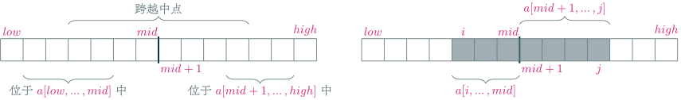

跨越中点的最大子数组涉及

- 求以$a[中点]$作结尾的最大子数组的开始索引
- 求以$a[四分位点]$作结尾的最大子数组的开始索引

对任意$i < 四分位点$，求和$a[i] + \cdots + a[四分位点]$会被重复计算

<!-- slide vertical=true data-notes="" -->

##### 最优子结构

---

子问题$i$：求以$a[i]$作结尾的最大子数组$a[j, \ldots, i]$的和

将这$n$个子问题求解完，其中和最大的就是原问题的最大子数组

最优子结构?

设$a[j, \ldots, i]$是以$a[i]$作结尾的最大子数组，则$a[j, \ldots, i-1]$也是以$a[i-1]$作结尾的最大子数组

证明：若$a[j', \ldots, i-1]$是以$a[i-1]$作结尾的最大子数组，且$j' \ne j$，则$a[j', \ldots, i]$是更大的以$a[i]$作结尾的最大子数组

<!-- slide vertical=true data-notes="" -->

##### 递推关系

---

最优子结构：设$a[j, \ldots, i]$是以$a[i]$作结尾的最大子数组，则$a[j, \ldots, i-1]$也是以$a[i-1]$作结尾的最大子数组

设$d[i]$是以$a[i]$作结尾的最大子数组的和，两种情况：

<ol>
    <li class="fragment">若$d[i-1] \ge 0$，直接把$a[i]$接在$a[j, \ldots, i-1]$的后面即可</li>
    <li class="fragment">若$d[i - 1] < 0$，加上$a[j, \ldots, i-1]$反而更小了，不如从$a[i]$重新开始</li>
</ol>

\begin{align}
    d[i] = \begin{cases} d[i-1] + a[i], & d[i-1] \ge 0 \Longleftrightarrow j < i \\ a[i], & d[i-1] < 0 \Longleftrightarrow j = i \end{cases}
\end{align}

<!-- slide data-notes="" -->

##### 实现

---

@import "../codes/dp/max-subarray-dp.py" {line_begin=0 line_end=14 .line-numbers highlight=[6]}

| $i$ |  0  |  1  |  2  |  3  |  4  |  5  |  6  |               7                |  8  |  9  |               10               | 11  | 12  | 13  | 14  | 15  |
| :-: | :-: | :-: | :-: | :-: | :-: | :-: | :-: | :----------------------------: | :-: | :-: | :----------------------------: | :-: | :-: | :-: | :-: | :-: |
| $a$ | 13  | -3  | -25 | 20  | -3  | -16 | -23 | 18 | 20  | -7  | 12 | -5  | -22 | 15  | -4  |  7  |
| $d$ | 13  | 10  | -15 | 20  | 17  |  1  | -22 |               18               | 38  | 31  |  43  | 38  | 16  | 31  | 27  | 34  |
| $s$ |  0  |  0  |  0  |  3  |  3  |  3  |  3  |               7                |  7  |  7  |  7   |  7  |  7  |  7  |  7  |  7  |

<!-- slide vertical=true data-notes="" -->

##### 优化空间复杂度

---

$d[i]$只依赖$d[i-1]$，因此不需要维护完整的$d$表，循环中可同步维护全局最优，$s$表也不需要

@import "../codes/dp/max-subarray-dp.py" {line_begin=22 line_end=40 .line-numbers highlight=[8]}

<!-- slide data-notes="" -->

##### 另一改进思路

---

子数组$a[low, ..., high]$的最大子数组为下面三者中的最大者：

- $a[low, ..., mid]$的最大子数组
- $a[mid + 1, ..., high]$的最大子数组
- 跨越中点的最大子数组

其中跨越中点的最大子数组的起始索引$i$需要从$mid$向前遍历确定；结束索引$j$需要从$mid + 1$向后遍历确定，因此$f(n) = \Theta(n)$，从而

\begin{align}
    T(n) = 2 \cdot T (n/2) + f(n) \Longrightarrow T(n) = \Theta(n \lg n)
\end{align}

根据主定理，要想改进$T(n)$，需优化$f(n)$

<!-- slide vertical=true data-notes="" -->

##### 另一改进思路

---

对任意子数组$a[l, ..., r]$

- 若维护以$l$为起始索引的最大子数组的和 (最大前缀和) 以及最大前缀的结束索引 (最大前缀终点)，则确定$j$只需$\Theta(1)$的时间 (将$mid+1$看作$l$)
- 若维护以$r$为结束索引的最大子数组的和 (最大后缀和) 以及最大后缀的起始索引 (最大后缀起点)，则确定$i$只需$\Theta(1)$的时间 (将$mid$看作$r$)

对每个子数组，还需要维护最大前缀、最大后缀

<ul class="fragment" data-fragment-index="1">
    <li>$a[l, ..., r]$的最大前缀要么等于$a[l, ..., m]$的最大前缀，要么等于$a[l, ..., m]$加上$a[m + 1, ..., r]$的最大前缀</li>
    <li>$a[l, ..., r]$的最大后缀要么等于$a[m+1, ..., r]$的最大后缀，要么等于$a[l, ..., m]$的最大后缀加上$a[m + 1, ..., r]$</li>
</ul>

对每个子数组，还需要维护全部元素和

<!-- slide vertical=true data-notes="" -->

##### 另一改进思路

---

综上，对每个子数组，维护八元组

1. 子数组总和
2. 最大前缀和
3. 最大前缀的结束索引
4. 最大后缀和
5. 最大后缀的起始索引
6. 最大子数组的和
7. 最大子数组的起始索引
8. 最大子数组的结束索引

由$a[low, ..., mid]$和$a[mid+1, ..., high]$的八元组得到$a[low, ..., high]$的八元组只需$\Theta(1)$的时间

\begin{align}
    T(n) = 2 \cdot T (n/2) + \Theta(1) \Longrightarrow T(n) = \Theta(n)
\end{align}

<!-- slide vertical=true data-notes="" -->

##### 另一改进思路 实现

---

@import "../codes/dc/max-subarray-dc.py" {line_begin=49 line_end=90 .line-numbers .bottom2 highlight=[]}

<!-- slide data-notes="" -->

##### 子集和数

---

输入：$n$个正整数的集合$W = \{ w_1, w_2, \ldots, w_n \}$和正整数$M$

输出：$W$中的和数等于$M$的所有子集

例 1：

- $n=4$，$(w_1, w_2, w_3, w_4) = (7, 11, 13, 24)$，$M = 31$
- 子集：$(7, 11, 13)$、$(7, 24)$

例 2：

- $n=6$，$(w_1, w_2, w_3, w_4, w_5, w_6) = (5, 10, 12, 13, 15, 18)$，$M = 30$
- 子集：$(5, 10, 15)$、$(5, 12, 13)$、$(12,18)$

<!-- slide vertical=true data-notes="" -->

##### 子问题

---

子问题：$\{ w_i, w_{i+1}, \ldots, w_n \}$的子集和为$m$

令$ss[i, m]$表示子问题是否有解，$ss[1, M]$即为所求目标

<ul>
    <li class="fragment">若$w[i]$不是和为$m$的加数之一，则$ss[i, m] = ss[i+1, m]$</li>
    <li class="fragment">若$w[i]$是和为$m$的加数之一，则$ss[i, m] = ss[i+1, m-w[i]]$</li>
</ul>

综上，$ss[i, m] = ss[i+1, m] \vee ss[i+1, m-w[i]]$

$i$从$1$开始每增大$1$，产生两个新的子问题，子问题总数为$2^n$

<!-- slide data-notes="" -->

##### 递推关系

---

子问题：$\{ w_i, w_{i+1}, \ldots, w_n \}$的子集和为$m$

令$ss[i, m]$表示子问题是否有解，$ss[1, M]$即为所求目标

$ss[i, m] = ss[i+1, m] \vee ss[i+1, m-w[i]]$

边界：

<ul>
    <li class="fragment">若$m = 0$，$ss[i, m]$恒为真</li>
    <li class="fragment">若$m < 0$或$i>n$，$ss[i, m]$恒为假</li>
</ul>

优化 (减少一个子问题)：

<ul>
    <li class="fragment">若$m < w[i]$，则$w[i]$必然不是加数之一，$ss[i, m] = ss[i+1, m]$</li>
</ul>

<!-- slide vertical=true data-notes="" -->

##### 递推关系

---

子问题：$\{ w_i, w_{i+1}, \ldots, w_n \}$的子集和为$m$

令$ss[i, m]$表示子问题是否有解，$ss[1, M]$即为所求目标

\begin{align}
    ss[i, m] = \begin{cases} \text{True}, & m = 0 \\ \text{False}, & m < 0 ~ 或 ~ i > n \\ ss[i+1, m], & m < w_i \\ ss[i+1, m] \vee ss[i+1, m-w_i], & 其它 \end{cases}
\end{align}

- 表$ss$的大小为$n \times (M+1)$，元素为布尔值
- 表第$0$列全部为真
- 第$i$行依赖第$i+1$行的元素，填表时从最后一行往前填

<!-- slide data-notes="" -->

##### 实现

---

令$ss[i, m]$表示子问题是否有解

\begin{align}
    ss[i, m] = \begin{cases} \text{True}, & m = 0 \\ \text{False}, & m < 0 ~ 或 ~ i > n \\ ss[i+1, m], & m < w_i \\ ss[i+1, m] \vee ss[i+1, m-w_i], & 其它 \end{cases}
\end{align}

@import "../codes/dp/subset-sum-dp.py" {line_begin=0 line_end=14 .line-numbers}

<!-- slide vertical=true data-notes="" -->

##### 重构解

---

@import "../codes/dp/subset-sum-dp.py" {line_begin=23 line_end=48 .line-numbers .bottom2}

<!-- slide data-notes="" -->

##### 时间分析

---

@import "../codes/dp/subset-sum-dp.py" {line_begin=0 line_end=14 .line-numbers highlight=[8-9]}

二重循环，时间复杂度$O(nM)$

<ul>
    <li class="fragment">若$M \ll 2^n$，动态规划可以带来显著收益</li>
    <li class="fragment">若$M \ge 2^n$，动态规划不如分治，计算了大量分治不会考虑的子问题</li>
</ul>

 不要无脑动态规划，它并不是总能有提升的

<!-- slide data-notes="" -->

##### 各问题复杂度一览

---

| 问题                  |   子问题数    | 子问题时间复杂度 |    时间复杂度     |  空间复杂度   |
| :-------------------- | :-----------: | :--------------: | :---------------: | :-----------: |
| 费波拿契数            |  $\Theta(n)$  |   $\Theta(n)$    |   $\Theta(n^2)$   |  $\Theta(n)$  |
| 钢条切割              |  $\Theta(n)$  |   $\Theta(n)$    |   $\Theta(n^2)$   |  $\Theta(n)$  |
| 矩阵连乘              | $\Theta(n^2)$ |   $\Theta(n)$    |   $\Theta(n^3)$   | $\Theta(n^2)$ |
| 最优二叉搜索树        | $\Theta(n^2)$ |   $\Theta(n)$    |   $\Theta(n^3)$   | $\Theta(n^2)$ |
| 最长公共子序列        | $\Theta(mn)$  |   $\Theta(1)$    |   $\Theta(mn)$    | $\Theta(mn)$  |
| 编辑距离              | $\Theta(mn)$  |   $\Theta(1)$    |   $\Theta(mn)$    | $\Theta(mn)$  |
| 最长递增子序列        |  $\Theta(n)$  |   $\Theta(n)$    |   $\Theta(n^2)$   |  $\Theta(n)$  |
| 最长递增子序列 (改进) |  $\Theta(n)$  | $\Theta(\lg n)$  | $\Theta(n \lg n)$ |  $\Theta(n)$  |
| 最大子数组 (分治)     |  $\Theta(n)$  |   $\Theta(1)$    |    $\Theta(n)$    |  $\Theta(1)$  |
| 最大子数组 (动态规划) |  $\Theta(n)$  |   $\Theta(1)$    |    $\Theta(n)$    |  $\Theta(1)$  |
| 子集和数 (分治)       | $\Theta(2^n)$ |   $\Theta(1)$    |   $\Theta(2^n)$   |  $\Theta(1)$  |
| 子集和数 (动态规划)   | $\Theta(nM)$  |   $\Theta(1)$    |   $\Theta(nM)$    | $\Theta(nM)$  |

<!-- slide vertical=true data-notes="" -->

##### 作业

---

课外阅读：算法导论 4ed 第十四章

计算题：14.2-1、14.4-1、14.5-2

设计题：14.1-3、14-9、14-11

证明题：14.2-5、14.3-5
