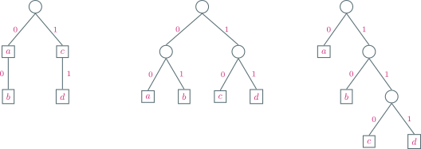
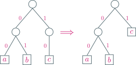
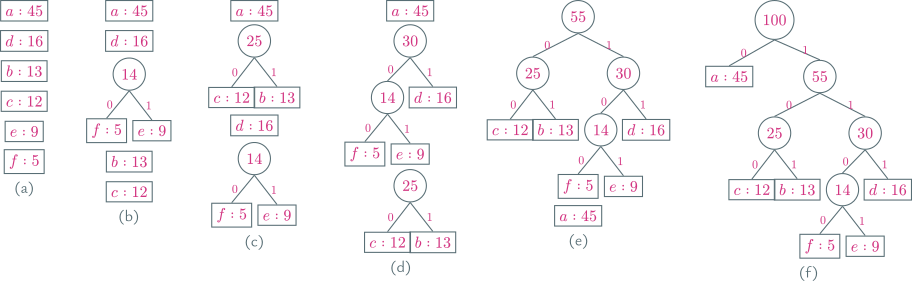
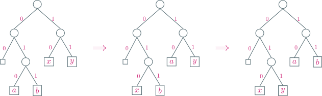
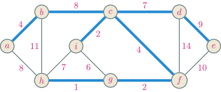
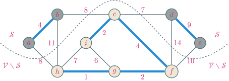
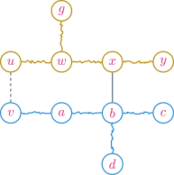
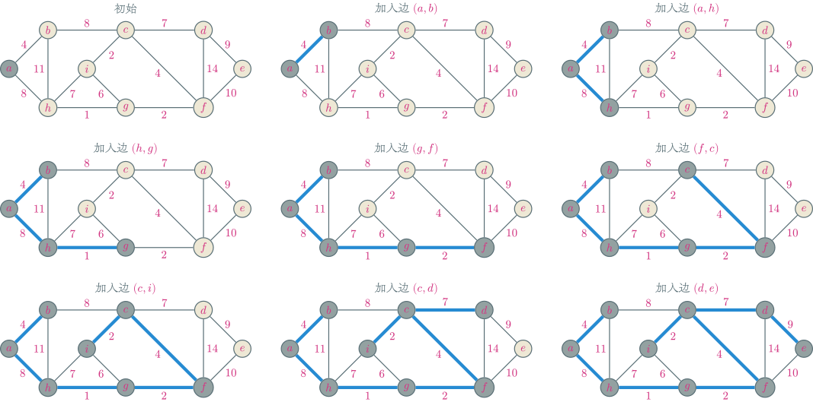
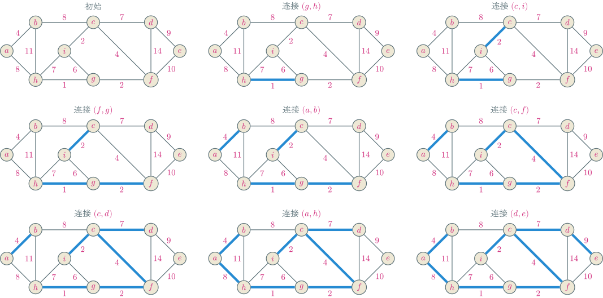

---
presentation:
  margin: 0
  center: false
  transition: "none"
  enableSpeakerNotes: true
  slideNumber: "c/t"
  navigationMode: "linear"
---

@import "../css/font-awesome-4.7.0/css/font-awesome.css"
@import "../css/theme/solarized.css"
@import "../css/logo.css"
@import "../css/font.css"
@import "../css/color.css"
@import "../css/margin.css"
@import "../css/table.css"
@import "../css/main.css"
@import "../plugin/zoom/zoom.js"
@import "../plugin/notes/notes.js"
@import "../plugin/customcontrols/plugin.js"
@import "../plugin/customcontrols/style.css"
@import "../plugin/chalkboard/plugin.js"
@import "../plugin/chalkboard/style.css"
@import "../plugin/reveal.js-menu/menu.js"

<!-- slide data-notes="" -->

# 算法设计与分析

## 贪心

### 计算机学院&emsp;张腾

#### *tengzhang@hust.edu.cn*

<!-- slide vertical=true data-notes="" -->

##### 课程大纲

---

@import "../vega/outline-greedy.json" {as="vega" .top-2}

<!-- slide data-notes="" -->

##### 磁带存储

---

读取一个文件时，它前面的文件都要被顺带读一遍

问题：现有$n$个文件要存储，先存谁?

<!-- slide data-notes="" -->

##### 形式化

---

记$n$个文件的编号分别为$1, \ldots, n$，长度分别为$L[1], \ldots, L[n]$

将这些文件按$\pi(1), \ldots, \pi(n)$的顺序存储到磁带上，其中$\pi(i)$表示磁带上第$i$个文件的实际文件编号

磁带上第$k$个文件的读取开销为

\begin{align}
    c(\pi(k)) = \sum_{i=1}^k L[\pi(i)]
\end{align}

所有文件的平均读取开销为

\begin{align}
    c (\pi) = \frac{1}{n} \sum_{k=1}^n c(\pi(k)) = \frac{1}{n} \sum_{k=1}^n \sum_{i=1}^k L[\pi(i)]
\end{align}

问题：求最优排列$\pi^\star$使平均读取开销$c (\pi)$最小

<!-- slide vertical=true data-notes="" -->

##### 暴力穷举 动态规划

---

很多共享资源的任务调度都属于这类问题

暴力穷举：遍历全排列，$\Omega(n!)$

动态规划？

最优子结构：设$\pi^\star(1), \ldots, \pi^\star(n)$是最优排列，则$\pi^\star(2), \ldots, \pi^\star(n)$是除$\pi^\star(1)$外所有文件的最优排列

递推关系？

 倒过来也可以，设$\pi^\star(1), \ldots, \pi^\star(n)$是最优排列，则$\pi^\star(1), \ldots, \pi^\star(n-1)$是除$\pi^\star(n)$外所有文件的最优排列

<!-- slide vertical=true data-notes="" -->

##### 动态规划

---

记$\ac = \{1, 2, \ldots, n\}$、$\ac_{-i} = \{1, 2, \ldots, n\} \setminus \{ i \}$

\begin{align}
    c (\pi, \ac) = \sum_{k=1}^n \frac{n+1-k}{n} L[\pi(k)] = L[\pi(1)] + \frac{n-1}{n} c (\pi, \ac_{-\pi(1)})
\end{align}

\begin{align}
    \pi^\star(1) = \argmin_{i \in \ac} \left\{ L[i] + \frac{n-1}{n} c (\pi^\star, \ac_{-i}) \right\}
\end{align}

时间复杂度？

<ul>
  <li class="fragment" data-fragment-index="3">确定$\pi^\star(1)$会产生$n$个规模为$n-1$的不同子问题</li>
  <li class="fragment" data-fragment-index="4">对每个子问题，确定$\pi^\star(2)$会产生$n-1$个规模为$n-2$的不同子问题</li>
  <li class="fragment" data-fragment-index="5">……</li>
  <li class="fragment" data-fragment-index="6">对每个子问题，确定$\pi^\star(n-1)$会产生$2$个规模为$1$的不同子问题</li>
</ul>

子问题总数为$n!$，动态规划与暴力穷举复杂度相当！

<!-- slide data-notes="" -->

##### 贪心

---

当前存入文件会出现在后续所有文件的读取开销中，故优先存短文件

贪心法：初始磁带为空，每轮迭代做贪心选择 - 将剩余文件中长度最短的文件存入磁带

和动态规划不同，贪心法每轮贪心选择后只产生一个子问题，时间复杂度与排序相同，$\Theta ( n \lg n )$

<!-- slide vertical=true data-notes="" -->

##### 贪心正确性

---

贪心法给出的就是$L[1], \ldots, L[n]$的升序排列$\pi^\ins$

对任意排列$\pi \ne \pi^\ins$，必存在$i$使得$L[\pi(i)] \ge L[\pi(i+1)]$，记交换文件$\pi(i)$、$\pi(i+1)$后得到的新排列为$\pi'$，则$c(\pi') \le c(\pi)$

证明：交换文件$\pi(i)$、文件$\pi(i+1)$后

<ul class="fragment" data-fragment-index="1">
  <li>文件$\pi(i)$在磁带上的位置往后挪了一位，读取开销增加$L[\pi(i+1)]$</li>
  <li>文件$\pi(i+1)$在磁带上的位置往前挪了一位，读取开销减少$L[\pi(i)]$</li>
  <li>其它文件的读取开销不变</li>
</ul>

平均读取开销变化$c(\pi') - c(\pi) = (L[\pi(i+1)] - L[\pi(i)]) / n \le 0$

对任意排列，包括$\pi^\star$，都可以通过上述读取开销变化非正的交换操作使其变成$\pi^\ins$，因此$\pi^\ins$就是最优排列

<!-- slide data-notes="" -->

##### 带读取频率

---

假设除长度外，还有读取频率$F[1], \ldots, F[n]$

读取磁带上第$k$个文件的开销为

\begin{align}
    c(\pi(k)) = \sum_{i=1}^k L[\pi(i)] F[\pi(k)]
\end{align}

所有文件的平均读取开销为

\begin{align}
    c(\pi) = \frac{1}{n} \sum_{k=1}^n c(\pi(k)) = \frac{1}{n} \sum_{k=1}^n \sum_{i=1}^k L[\pi(i)] F[\pi(k)]
\end{align}

假设所有文件长度相同，则应优先存高频文件，不难猜正确的贪心选择为：将剩余文件中长度/频率最小的文件存入磁带

<!-- slide vertical data-notes="" -->

##### 贪心正确性

---

对任意排列$\pi \ne \pi^\greedy$，必存在$i$使得$\frac{L[\pi(i)]}{F[\pi(i)]} \ge \frac{L[\pi(i+1)]}{F[\pi(i+1)]}$，记交换文件$\pi(i)$、$\pi(i+1)$后得到的新排列为$\pi'$，则$c(\pi') \le c(\pi)$

证明：交换文件$\pi(i)$、文件$\pi(i+1)$后

<ul class="fragment" data-fragment-index="1">
  <li>文件$\pi(i)$往后挪了一位，读取开销增加$F[\pi(i)] L[\pi(i+1)]$</li>
  <li>文件$\pi(i+1)$往前挪了一位，读取开销减少$F[\pi(i+1)] L[\pi(i)]$</li>
  <li>其它文件的读取开销不变</li>
</ul>

平均读取开销变化非正：

\begin{align}
    c(\pi') - c(\pi) & = \frac{1}{n} (F[\pi(i)] L[\pi(i+1)] - F[\pi(i+1)] L[\pi(i)]) \\
    & = \frac{1}{n} F[\pi(i+1)] F[\pi(i)] \left( \frac{L[\pi(i+1)]}{F[\pi(i+1)]} - \frac{L[\pi(i)]}{F[\pi(i)]} \right) \le 0
\end{align}

<!-- slide data-notes="" -->

##### 贪心

---

将问题看作连续决策，每次决策做贪心选择，只产生一个规模更小的子问题

优缺点

- 优点：易设计贪心选择 (不一定正确)，易分析时间复杂度
- 缺点：贪心选择的正确性证明较难，只对部分最优化问题有效

经典算法

- 霍夫曼编码
- 最小生成树的 Prim 算法、Kruskal 算法
- 单源最短路径的 Dijkstra 算法

<!-- slide data-notes="" -->

##### 活动安排 延迟总和

---

现有$n$个活动，编号分别为$1, \ldots, n$，时长分别为$L[1], \ldots, L[n]$，最后期限为$D[1], \ldots, D[n]$

在安排方案$\pi$中，第$k$个活动的结束时间为$c (\pi(k)) = \sum_{i=1}^k L[\pi(i)]$，记延迟$\lambda (\pi(k)) = \max \{ 0, c (\pi(k)) - D[\pi(k)] \}$

问题：求最优排列$\pi^\star$使延迟总和$\sum_{k=1}^n \lambda (\pi(k))$最小

以下哪个不是正确的贪心选择？

<ul>
  <li class="fragment" data-fragment-index="2">按照时长$L[k]$的升序，优先安排不太耗时的活动</li>
  <li class="fragment" data-fragment-index="3">按照最后期限$D[k]$的升序，优先安排时间紧的活动</li>
  <li class="fragment" data-fragment-index="4">按照$L[k] + D[k]$的升序安排活动</li>
  <li class="fragment" data-fragment-index="5">按照$L[k] \cdot D[k]$的升序安排活动</li>
</ul>

<!-- slide vertical=true data-notes="" -->

##### 反例

---

假设有两个活动：

- 活动$1$：$L[1] = 10$、$D[1] = 25$
- 活动$2$：$L[2] = 20$、$D[2] = 20$

- 先活动$1$、后活动$2$：$\lambda (1) = 0$、$\lambda (2) = 10$
- 先活动$2$、后活动$1$：$\lambda (1) = 5$、$\lambda (2) = 0$

按$L[k]$、$L[k] + D[k]$、$L[k] \cdot D[k]$升序都是先活动$1$、后活动$2$，因此都不是正确的贪心选择

<!-- slide vertical=true data-notes="" -->

##### 反例

---

假设有两个活动：

- 活动$1$：$L[1] = 20$、$D[1] = 10$
- 活动$2$：$L[2] = 10$、$D[2] = 15$

- 先活动$1$、后活动$2$：$\lambda (1) = 10$、$\lambda (2) = 15$
- 先活动$2$、后活动$1$：$\lambda (1) = 20$、$\lambda (2) = 0$

按$D[k]$升序是先活动$1$、后活动$2$，不是正确的贪心选择

<!-- slide data-notes="" -->

##### 活动安排 最大延迟

---

问题：求最优排列$\pi^\star$使最大延迟$\max_k \lambda (\pi(k))$最小

假设有两个活动：

- 活动$1$：$L[1] = 10$、$D[1] = 50$
- 活动$2$：$L[2] = 100$、$D[2] = 20$

- 先活动$1$、后活动$2$：$\lambda (1) = 0$、$\lambda (2) = 90$
- 先活动$2$、后活动$1$：$\lambda (1) = 80$、$\lambda (2) = 60$

除按$D[k]$升序外其它都是先活动$1$、后活动$2$，都不是正确的贪心选择

按$D[k]$升序是正确的贪心选择吗？

<!-- slide vertical=true data-notes="" -->

##### 正确性证明

---

对任意活动排列$\pi$，若存在$i$使得$D[\pi(i)] \ge D[\pi(i+1)]$，记交换活动$\pi(i)$、$\pi(i+1)$后得到新排列$\pi'$

其它活动的延迟情况不变，记$M = \sum_{j=1}^{i-1} L[\pi(j)]$

- $\lambda (\pi(i)) = \max \{0, M + L[\pi(i)] - D[\pi(i)]\}$
- $\lambda (\pi(i+1)) = \max \{0, M + L[\pi(i)] + L[\pi(i+1)] - D[\pi(i+1)]\}$
- $\lambda (\pi'(i)) = \max \{0, M + L[\pi(i+1)] - D[\pi(i+1)]\}$
- $\lambda (\pi'(i+1)) = \max \{0, M + L[\pi(i)] + L[\pi(i+1)] - D[\pi(i)]\}$

显然$\lambda (\pi'(i)) \le \lambda (\pi(i+1))$、$\lambda (\pi'(i+1)) \le \lambda (\pi(i+1))$，故

\begin{align}
    \max \{ \lambda (\pi'(i)), \lambda (\pi'(i+1)) \} \le \lambda (\pi(i+1)) \le \max \{ \lambda (\pi(i)), \lambda (\pi(i+1)) \}
\end{align}

<!-- slide data-notes="" -->

##### 活动选择

---

现有$n$个活动$\sc = \{ a_1, a_2, \ldots, a_n \}$，活动$a_i$的时间段为$[s_i, f_i)$

这些活动使用同一资源且不能共用，如会场等

如果两个活动的时间段不重叠，则称它们是兼容的

输入：$\sc = \{ a_1 = [s_1, f_1), a_2 = [s_2, f_2), \ldots, a_n = [s_n, f_n) \}$

输出：从$\sc$中选出最大兼容活动集合

假设活动已按结束时间升序排列，即$f_1 \le f_2 \le \cdots \le f_n$

<!-- slide vertical=true data-notes="" -->

##### 例子

---

有$n = 11$个活动

|  $i$  |  1  |  2  |  3  |  4  |  5  |  6  |  7  |  8  |  9  | 10  | 11  |
| :---: | :-: | :-: | :-: | :-: | :-: | :-: | :-: | :-: | :-: | :-: | :-: |
| $s_i$ |  1  |  3  |  0  |  5  |  3  |  5  |  6  |  8  |  8  |  2  | 12  |
| $f_i$ |  4  |  5  |  6  |  7  |  9  |  9  | 10  | 11  | 12  | 14  | 16  |

$\{ a_3, a_9, a_{11} \}$、$\{ a_1, a_4, a_8, a_{11} \}$、$\{ a_2, a_4, a_9, a_{11} \}$是兼容活动集合

后两者都是最大兼容活动集合，最大兼容活动集合不唯一

暴力穷举：遍历所有子集，$\Omega(2^n)$

<!-- slide data-notes="" -->

##### 最优子结构

---

子问题：设$\sc_{ij}$表示$a_i$结束后开始、$a_j$开始前结束的活动集合

\begin{align}
    \sc_{ij} & = \{ a_k = [s_k, f_k) \mid f_i \le s_k < f_k \le s_j \}
\end{align}

求$\sc_{ij}$的最大兼容活动集合

最优子结构：设$\ac_{ij}$是$\sc_{ij}$的最大兼容活动集合，且$\ac_{ij}$包含$a_k$

<ul class="fragment" data-fragment-index="2">
    <li>$\ac_{ij}$中$a_k$开始前结束的活动集合$\ac_{ik}$也是$\sc_{ik}$的最大兼容活动集合</li>
    <li>$\ac_{ij}$中$a_k$结束后开始的活动集合$\ac_{kj}$也是$\sc_{kj}$的最大兼容活动集合</li>
    <li>$\ac_{ij} = \ac_{ik} \cup \{a_k\} \cup \ac_{kj}$</li>
</ul>

若$\ac_{ik}$不是最大，存在$\ac'_{ik}$更大，则$\ac'_{ik} \cup \{a_k\} \cup \ac_{kj}$更大，矛盾

<!-- slide vertical=true data-notes="" -->

##### 动态规划

---

设$\ac_{ij}$包含$a_k$，$\ac_{ij} = \ac_{ik} \cup \{a_k\} \cup \ac_{kj}$

令$c[i,j] = |\ac_{ij}|$表示$\sc_{ij}$的最大兼容活动集合的大小

\begin{align}
    c[i,j] & = c[i,k] + c[k,j] + 1 \\[5px]
    & \Longrightarrow c[i,j] = \begin{cases} 0, & \sc_{ij} = \emptyset \\ \max_{a_k \in \sc_{ij}} \{ c[i,k] + c[k,j] + 1 \}, & \sc_{ij} \ne \emptyset \end{cases}
\end{align}

动态规划：时间复杂度$\Theta(n^3)$，空间复杂度$\Theta(n^2)$

<!-- slide data-notes="" -->

##### 贪心

---

初始化最大兼容活动集合$\ac = \emptyset$，不断将与$\ac$兼容的活动加入$\ac$

贪心选择：选择与$\ac$兼容的活动中结束时间最早的活动，使剩余可安排时间最大化，给未来留下足够的余地

<ul class="fragment" data-fragment-index="2">
    <li>首次选择$a_1$</li>
    <li>其后选择结束时间最早 (贪心) 且开始时间不早于前一个所选活动结束时间 (兼容) 的活动</li>
</ul>

时间复杂度

<ul class="fragment" data-fragment-index="3">
    <li>若活动已排好序，只需$\Theta(n)$的时间遍历一遍活动集合</li>
    <li>若活动未排好序，可先用$\Theta(n \lg n)$的时间重排序</li>
</ul>

<!-- slide vertical=true data-notes="" -->

##### 例子

---

@import "../mermaid/activity-selector.mermaid"

<!-- slide vertical=true data-notes="" -->

##### 实现

---

@import "../codes/greedy/activity-selector.py" {line_begin=0 line_end=14 .line-numbers}

@import "../codes/greedy/activity-selector.py" {line_begin=16 line_end=24 .line-numbers .fragment}

<!-- slide data-notes="" -->

##### 贪心正确性

---

设贪心法得到的兼容活动集合为

\begin{align}
    \sc^\greedy = \{ g_1, ~ g_2, ~ \ldots, g_{i-1}, ~ g_i, ~ g_{i+1}, ~ \ldots, ~ g_k \}
\end{align}

任意最大兼容活动集合$\sc \ne \sc^\greedy$可表示为

\begin{align}
    \sc = \{ g_1, ~ g_2, ~ \ldots, g_{i-1}, ~ c_i, ~ c_{i+1}, ~ \ldots, ~ c_l \}
\end{align}

将$c_i$替换为$g_i$得到新的最大兼容活动集合 (替换的合法性？)

\begin{align}
    \sc' = \{ g_1, ~ g_2, ~ \ldots, g_{i-1}, ~ g_i, ~ c_{i+1}, ~ \ldots, ~ c_l \}
\end{align}

对任意最大兼容活动集合，都可以通过替换活动使其变成$\sc^\greedy$，因此$\sc^\greedy$就是最大兼容活动集合

<!-- slide data-notes="" -->

##### 阶段性小结

---

一般步骤

1. 确定问题的最优子结构
2. 将问题看作连续决策，每次贪心选择后只产生一个小规模的子问题

必要条件

1. 最优子结构
2. 可贪心选择

正确性证明：若最优解不等于贪心解，对其进行剪切-粘贴，将其一部分替换为贪心选择，证明这样构造出的解不失最优性

<!-- slide data-notes="" -->

##### 文件编码

---

压缩一个只包含$a$、$b$、$c$、$d$、$e$、$f$的$100$个字符的数据文件

|   字符   |  $a$  |  $b$  |  $c$  |  $d$  |  $e$   |  $f$   |
| :------: | :---: | :---: | :---: | :---: | :----: | :----: |
|   频率   | $45$  | $13$  | $12$  | $16$  |  $9$   |  $5$   |
| 定长编码 | $000$ | $001$ | $010$ | $011$ | $100 $ | $101$  |
| 变长编码 |  $0$  | $101$ | $100$ | $111$ | $1101$ | $1100$ |

- 定长编码：$3 \cdot 100 = 300$个二进制位
- 变长编码：$1 \cdot 45 + 3 \cdot 13 + 3 \cdot 12 + 3 \cdot 16 + 4 \cdot 9 + 4 \cdot 5 = 224$个二进制位，节省$25.3\%$空间

问题：最优编码方案？

<!-- slide vertical=true data-notes="" -->

##### 编码树

---

任何二进制编码都可以表示成一个二叉树，根结点到字符结点路径上遇到的$01$串就是其编码，以表示$a$、$b$、$c$、$d$四字符为例

- 左：$a:0$、$b:00$、$c:1$、$d:11$，$a$的编码是$b$的前缀，解码时有歧义
- 中：$a:00$、$b:01$、$c:10$、$d:11$，等长编码，解码时无歧义
- 右：$a:0$、$b:10$、$c:110$、$d:111$，变长编码，解码时无歧义

解码：以右图方案为例，010110 -> abc

<!-- slide vertical=true data-notes="" -->

##### 最优非前缀编码树

---

输入：字符表$\cc$，字符个数$n = |\cc| \ge 2$，每个字符$c$的频率$c.f$

输出：最优非前缀编码树

两点说明：

<ul>
    <li class="fragment" data-fragment-index="2">每个字符对应一个叶结点，否则不是非前缀码</li>
    <li class="fragment" data-fragment-index="3">最优编码树必然是满二叉树，每个内部结点有两个子结点</li>
</ul>

<!-- slide data-notes="" -->

##### 霍夫曼算法

---

基本想法：维护一个森林，初始为每个字符对应的单结点树，每次决策合并两棵树，连续决策直到所有树合并成一棵树

字符$c$的编码长度是其在编码树$\tc$中的深度$\dep_{\tc}(c)$，所有字符的总编码长度$B(\tc) = \sum_{c \in \cc} c.f \cdot \dep_{\tc}(c)$

每次合并会导致树中结点深度$+1$，总编码长度$B(\tc)$的增量为两棵树中字符对应的叶结点的频率和

霍夫曼算法的贪心选择：合并叶结点频率和最低的两棵树

 该算法来自霍夫曼在 MIT 攻读博士学位时修读的信息论课程的学期报告：最有效的二进制编码，老师法诺曾提出自顶向下构建树的香农-范诺编码，霍夫曼使用自底向上构建树得到了更优的编码

<!-- slide vertical=true data-notes="" -->

##### 霍夫曼算法

---

霍夫曼算法的贪心选择：合并叶结点频率和最低的两棵树

- 在字符对应的叶结点中保存字符的频率
- 每次合并产生一个新的根结点，根结点中保存两个子结点的频率和，于是每个结点中保存的就是以其为根结点的子树中叶结点的频率和
- 每次选择两个频率最低的结点进行合并

<!-- slide vertical=true data-notes="" -->

##### 两种实现

---

初级实现：利用列表保存结点，总时间复杂度$\Theta(n^2)$

- 初始化列表$\Theta(n)$
- 每次合并两个结点，共合并$\Theta(n)$次
- 弹出频率最低的两个结点，线性查找$\Theta(n)$、删除$\Theta(1)$
- 插入合并的结点$\Theta(1)$

高级实现：利用二叉堆保存结点，总时间复杂度$\Theta(n \lg n)$

<ul class="fragment" data-fragment-index="1">
    <li>初始化二叉堆，逐元素加入则为$\Theta(n \lg n)$、从列表原地转换则为$\Theta(n)$</li>
    <li>每次合并两个结点，共合并$\Theta(n)$次</li>
    <li>每次合并需要查找频率最低的两个结点$\Theta(1)$</li>
    <li>弹出频率最低的两个结点，查找$\Theta(1)$、删除$\Theta(\lg n)$</li>
    <li>插入合并的结点$\Theta(\lg n)$</li>
</ul>

<!-- slide vertical=true data-notes="" -->

##### 两种实现

---

@import "../codes/greedy/huffman.py" {.line-numbers .bottom2}

<!-- slide data-notes="" -->

##### 正确性

---

磁带存储和最大兼容活动两个问题解的形式都是序列

证明思路：

- 假设贪心给出解序列$s^\greedy$，最优解序列$s^\star \ne s^\greedy$
- 证明通过一些不失最优性的操作可将$s^\star$变成$s^\greedy$，从而$s^\greedy$也是最优解

以此类推：文件编码问题解的形式是编码树 (满二叉树)

- 假设贪心给出编码树$\tc^\greedy$，最优编码树$\tc^\star \ne \tc^\greedy$
- 如何通过不失最优性的操作将$\tc^\star$变成$\tc^\greedy$？

<!-- slide vertical=true data-notes="" -->

##### 正确性

---

设$x$和$y$是$\cc$中频率最低的两个字符，霍夫曼算法首轮将$x$和$y$合并成字符$z$，且其频率$z.f = x.f + y.f$，此时字符表变成$\cc' = \cc \setminus \{ x,y \} \cup \{ z \}$，只剩$n-1$个字符，数学归纳法？

对字符表的字符个数$n$做归纳

边界情况：只有$n = 2$个字符，最优编码为一个字符编码为$0$，另一个编码为$1$，霍夫曼算法的结果亦是如此

归纳假设：霍夫曼算法对$n-1$个字符的字符表能输出最优编码树，特别的对$\cc'$输出最优编码树$\tc'$

<!-- slide vertical=true data-notes="" -->

##### 正确性

---

将$\tc'$中$z$对应的叶结点替换为以$x$、$y$为叶结点的内部结点 (树桩)，所得编码树$\tc$就是霍夫曼算法对$\cc$输出的编码树

总编码长度的变化量是个定值

\begin{align}
    B(\tc) & - B(\tc') = x.f \cdot \dep_{\tc}(x) + y.f \cdot \dep_{\tc}(y) - z.f \cdot \dep_{\tc'}(z) \\
    & = x.f \cdot (\dep_{\tc'}(z) + 1) + y.f \cdot (\dep_{\tc'}(z) + 1) - (x.f+y.f) \cdot \dep_{\tc'}(z) \\
    & = x.f+y.f
\end{align}

不仅仅是$\tc'$，对任一关于$\cc'$的编码树都是如此

$\tc'$关于$\cc'$最优，因此$\tc$在关于$\cc$且$x$、$y$为一对兄弟结点的编码树中最优

断言：$x$、$y$是$\tc$中深度最深的一对兄弟结点

<!-- slide vertical=true data-notes="" -->

##### 正确性

---

设$a$、$b$是更深的一对兄弟节点，则交换$a$、$x$可减小总编码长度

\begin{align}
    \Delta B & = a.f \cdot (\dep_{\tc}(x) - \dep_{\tc}(a)) + x.f \cdot (\dep_{\tc}(a) - \dep_{\tc}(x)) \\
    & = \underbrace{(a.f ~ - ~ x.f)}_{> ~ 0} \underbrace{(\dep_{\tc}(x) ~ - ~ \dep_{\tc}(a))}_{< ~ 0} < 0
\end{align}

同理，交换$b$、$y$可减小总编码长度

同理，对关于$\cc$且$x$、$y$不为一对兄弟结点的编码树，将$x$、$y$和最深的一对兄弟结点交换可减小总编码长度，这就证明了$\tc$的最优性

<!-- slide data-notes="" -->

##### 最小生成树

---

输入：带权无向连通图$\gc = (\vc, \ec)$，其中$\vc$为点集、$\ec$为边集，边上的权重由函数$w: \ec \mapsto \rb$给出

输出：最小生成树 (minimum spanning tree, MST)

去掉边$(b,c)$，加上边$(a,h)$，也是 MST，MST 不唯一！

<!-- slide vertical=true data-notes="" -->

##### 唯一性

---

唯一性与权重有关，若所有边权重相同，则任意 ST 都是 MST

定理：若$\gc$的边权重各不相同，则其 MST 唯一

证明逆否命题：若$\tc$、$\tc'$是不同的 MST，则$\gc$存在权重相同的边

$\tc$、$\tc'$不同 => $\tc$中存在不属于$\tc'$的边，设权重最小的为$e$、$\tc'$中存在不属于$\tc$的边，设权重最小的为$e'$，不妨设$w(e') \ge w(e)$

$\tc'$是树 => $\tc' \cup \{ e \}$包含环$\cc$ => $\cc$中包含边$e'' \not \in \tc$ => $w(e'') \ge w(e')$

生成树$\tc'' = \tc' \cup \{ e \} \setminus \{ e'' \} $也是最小生成树 => $w(e) = w(e'')$

<!-- slide data-notes="" -->

##### 最小生成树 贪心

---

连续决策：

- 初始化边集$\ac = \emptyset$
- 每轮选择一条边$(u,v)$加入$\ac$，保证$\ac$始终是某棵 MST 的子集

问题：如何选择边$(u,v)$？

<!-- slide data-notes="" -->

##### 切割 轻量边

---

切割：无向图$\gc = (\vc, \ec)$的切割$(\sc, \vc \setminus \sc)$是$\vc$的一个划分

横跨切割边：边的两个端点分属于$\sc$和$\vc \setminus \sc$，例如$(a,h)$

尊重：如果集合$\ac$中没有横跨切割的边，称该切割尊重$\ac$

轻量边：横跨切割边中权重最小的边，例如$(c,d)$

<!-- slide vertical=true data-notes="" -->

##### 如何选择边

---

贪心：每轮对任意尊重当前$\ac$的切割，选择轻量边$(u,v)$加入

正确性证明：设$\tc$是任一包含$\ac$的 MST，但$(u,v) \not \in \tc$

$\tc$中存在$u$到$v$的路径$p = \class{yellow}{u \rightsquigarrow w \rightsquigarrow x} \rightsquigarrow \class{blue}{b \rightsquigarrow a \rightsquigarrow v}$

$p$中必有一边横跨切割，不妨设为$(x,b)$

$\tc' = \tc \setminus \{ (x,b) \} \cup \{ (u,v) \}$也是 MST

$\ac \cup \{ (u,v) \} \subseteq \tc'$

<!-- slide data-notes="" -->

##### Prim 算法

---

$\ac$始终是一棵树

- 初始时$\ac$是某个单结点树
- 每次加入连接$\ac$和$\ac$之外结点的权重最小的边
- $\ac$作为切割的一方，$\ac$之外的结点作为切割另一方

<!-- slide vertical=true data-notes="" -->

##### Prim 算法

---

$\ac$始终是一棵树，每次加入连接$\ac$和$\ac$之外结点的权重最小边

<!-- slide vertical=true data-notes="" -->

##### Prim 算法

---

基于二叉堆的实现，时间复杂度$O((|\vc| + |\ec|) \lg |\vc|)$

@import "../codes/greedy/mst-prim.py" {line_begin=3 .line-numbers .bottom2}

<!-- slide data-notes="" -->

##### Kruskal 算法

---

$\ac$始终是一个森林

- 初始时$\ac$是所有单结点树构成的森林
- 每次加入连接$\ac$中不同两棵树的权重最小的边
- 两棵树作为切割的两方，其它树随意属于某一方

<!-- slide vertical=true data-notes="" -->

##### Kruskal 算法

---

$\ac$始终是一个森林，每次加入连接$\ac$中两棵树的权重最小边

<!-- slide vertical=true data-notes="" -->

##### Kruskal 算法

---

基于并查集的实现，时间复杂度$O((|\vc| + |\ec|) \lg |\vc|)$

@import "../codes/greedy/mst-kruskal.py" {line_begin=0 .line-numbers .bottom2}

<!-- slide data-notes="" -->

##### 作业

---

课外阅读：算法导论 4ed 第十五章

15.1-4、15.2-7、15.3-3、15-1
