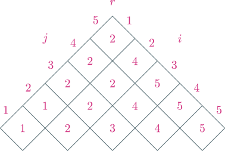

---
presentation:
  margin: 0
  center: false
  transition: "none"
  enableSpeakerNotes: true
  slideNumber: "c/t"
  navigationMode: "linear"
---

@import "../css/font-awesome-4.7.0/css/font-awesome.css"
@import "../css/theme/solarized.css"
@import "../css/logo.css"
@import "../css/font.css"
@import "../css/color.css"
@import "../css/margin.css"
@import "../css/table.css"
@import "../css/main.css"
@import "../plugin/zoom/zoom.js"
@import "../plugin/notes/notes.js"
@import "../plugin/customcontrols/plugin.js"
@import "../plugin/customcontrols/style.css"
@import "../plugin/chalkboard/plugin.js"
@import "../plugin/chalkboard/style.css"
@import "../plugin/reveal.js-menu/menu.js"

<!-- slide data-notes="" -->

##### 构造最优解

---

$r[i,j]$表示仅包含$k_i, \ldots, k_j$和$d_{i-1}, \ldots, d_j$的 OBST 的根结点

- $r[1,5]=2$，故$k_2$是 OBST 的根结点
- $r[1,1]=1$，故$k_2$的左子结点是$k_1$
- $r[3,6]=5$，故$k_2$的右子结点是$k_5$

@import "../codes/dp/optimal-bst.py" {line_begin=23 line_end=46 .left2 .line-numbers .top-8 .bottom4}

<!-- slide vertical=true data-notes="" -->

##### 实现

---

@import "../codes/dp/optimal-bst.py" {line_begin=48 line_end=100 .left2 .line-numbers .top0 .bottom0}
